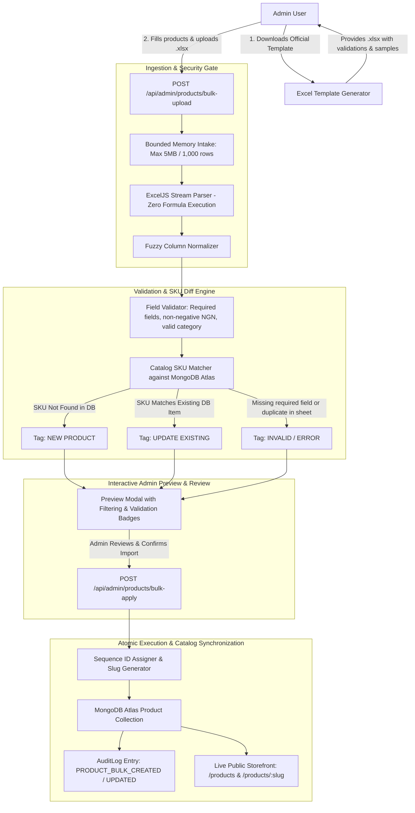

# Architecture Specification: Bulk Product Creation & Catalog Management via Excel

**Document Version:** 1.0.0  
**Status:** Under Architecture Review  
**Target Platform:** DEVICE PRO E-Commerce & Administrative Operations Platform  
**Authors:** DEVICE PRO Core Engineering & Antigravity AI  

---

## 1. Executive Summary & Objective

Currently, adding products to DEVICE PRO requires manual single-product entry through the administrative modal (`#modal-add-product`), while the bulk import feature is focused on revising prices of already existing items.

This architecture specifies a full **Bulk Product Creation & Catalog Management Engine via Excel (`.xlsx` / `.csv`)**. It empowers administrators and commercial procurement teams to:
1. **Batch-create brand-new solar equipment** (Panels, Inverters, Batteries, Turnkey Packages, Accessories, Portable Stations) complete with names, specifications, descriptions, warranty, and selling prices directly from a single Excel spreadsheet.
2. **Intelligently upsert existing products** (update pricing, stock quantity, specs, or images if the SKU already exists in the catalog).
3. **Download an official, standardized Excel template** with pre-filled column validations, category drop-downs, and sample solar hardware rows.
4. **Preview and review incoming products** before applying changes, distinguishing between 🟢 `NEW PRODUCT` (to be created) and 🔵 `UPDATE EXISTING` (to be updated), with complete audit logging.

---

## 2. End-to-End System Architecture



---

## 3. Standardized Excel Template & Data Dictionary

The Excel spreadsheet will feature a frozen header row styled with DEVICE PRO brand navy (`#0157A2`), clean typography, number formatting, and standard column headers:

| # | Column Header in Excel | Field in Database | Required? | Accepted Values / Type | Example Value | Description |
|---|:---|:---|:---:|:---|:---|:---|
| **1** | `Product Name` | `name` | **YES** | String (3–150 chars) | `Jinko Solar 620W Tiger Neo N-Type Panel` | Full commercial title displayed in catalog and page |
| **2** | `SKU` | `sku` | **YES** | String (Unique code) | `JKM-620N-78HL4` | Hardware inventory SKU (primary identifier for upserts) |
| **3** | `Category` | `category` | **YES** | `Solar Panels`, `Inverters`, `Batteries`, `Packages`, `Accessories`, `Portable Power` | `Solar Panels` | Automatically normalized to canonical slug (e.g. `solar-panels`) |
| **4** | `Brand` | `brand` | Optional | String | `Jinko Solar` | Manufacturer name (defaults to `DEVICE PRO` if omitted) |
| **5** | `Selling Price (NGN)` | `price_ngn` | **YES** | Positive Integer | `310,000` | Retail price displayed to customers on storefront |
| **6** | `Cost Price (NGN)` | `cost_price_ngn` | Optional | Non-negative Integer | `270,000` | Supplier wholesale cost for internal profit tracking |
| **7** | `Previous Price (NGN)` | `previous_price_ngn` | Optional | Non-negative Integer | `340,000` | If set, shows strikethrough original price on storefront |
| **8** | `Power Rating` | `power_rating` | Optional | String | `620W` | Wattage / capacity label (e.g. `620W`, `5kVA`, `10kWh`) |
| **9** | `Power Tier` | `power_tier` | Optional | `up_to_1kw`, `1kw_5kw`, `5kw_10kw`, `10kw_50kw` | Auto-derived from power rating if blank | System capacity category for filter navigation |
| **10** | `Warranty (Years)` | `warranty_years` | Optional | Integer (1–30) | `25` | Manufacturer warranty years (defaults to 5) |
| **11** | `Stock Status` | `stock_status` | Optional | `in_stock`, `low_stock`, `pre_order` | `in_stock` | Availability indicator for cart & checkout |
| **12** | `Stock Quantity` | `stock_quantity` | Optional | Positive Integer | `100` | Warehouse unit count (defaults to 50) |
| **13** | `Short Description` | `description` (lead) | Optional | String (max 250 chars) | `High-efficiency bifacial N-type monocrystalline solar module.` | Displayed on catalog card and meta descriptions |
| **14** | `Full Description` | `description` (body) | Optional | String (Markdown/HTML) | `Engineered for high-temperature resilience in Nigerian climate...` | Narrative overview displayed on product detail page |
| **15** | `Technical Specifications` | `specifications` | Optional | Key:Value pairs separated by `\|` | `Efficiency: 22.8% \| Cell: Monocrystalline \| Frame: Anodized Aluminum` | Formatted specs grid on `/products/:slug` |
| **16** | `Image URL` | `image_url` | Optional | URL or relative path | `/images/products/jinko-620w.webp` | Main photo (defaults to high-res category SVG if empty) |
| **17** | `Featured` | `featured` | Optional | `YES` / `NO` (or `1` / `0`) | `YES` | Pin to homepage and top of category catalog |

---

## 4. Processing Pipeline & Business Logic

### Phase 1: Intake & Security Sanitization
- **File Format Acceptance:** Strict mime-type validation accepting `.xlsx`, `.xls`, and `.csv`.
- **Memory Buffer:** Processed entirely in memory via `ExcelJS` without saving temporary files to disk.
- **Formula & Macro Prevention:** Strips all formulas, macros, and executable script payloads; evaluates plain numeric and string cell values only.
- **Size Bounds:** Max 5MB file size, max 1,000 product rows per batch to prevent event-loop latency.

### Phase 2: Fuzzy Column Mapping
The engine uses intelligent alias matching so administrators do not have to worry about exact header casing:
- `Product Name` matches: `name`, `product`, `item name`, `title`, `description`
- `SKU` matches: `supplier sku`, `item code`, `part number`, `model`
- `Selling Price` matches: `price`, `selling price`, `retail price`, `price (ngn)`, `rate`
- `Category` matches: `category`, `cat`, `type`, `group`

### Phase 3: Validation, Normalization & Diffing
1. **Slug Generation:**  
   New products are assigned a clean, SEO-friendly slug:  
   `slug = name.toLowerCase().replace(/[^a-z0-9]+/g, '-').replace(/(^-|-$)/g, '')`  
   If a slug collision occurs, the engine appends the SKU suffix: `${slug}-${sku.toLowerCase()}`.
2. **Category Mapping:**  
   Maps incoming category string to standard database categories:
   - "Solar Panels", "Panels", "PV" → `solar-panels` (Label: "Solar Panels")
   - "Inverters", "Hybrid Inverter" → `inverters` (Label: "Inverters")
   - "Batteries", "Storage", "Lithium" → `batteries` (Label: "Batteries")
   - "Packages", "Kits", "Turnkey" → `solar-packages` (Label: "Solar Packages")
   - "Accessories", "Cables", "Mounting" → `accessories` (Label: "Accessories")
   - "Portable Power", "Power Station" → `portable-power` (Label: "Portable Power")
3. **Row Classification:**
   - **`CREATE_NEW`**: SKU is absent in MongoDB Atlas. System will create a new product ID and document.
   - **`UPDATE_EXISTING`**: SKU exists in MongoDB Atlas. System will update existing fields while preserving historical analytics.
   - **`VALIDATION_ERROR`**: Missing `Product Name`, invalid/missing `Selling Price`, or duplicate SKU within the uploaded spreadsheet itself.

### Phase 4: Atomic Database Execution
- Uses MongoDB bulk operations (`bulkWrite`) for fast, atomic updates.
- Auto-increments sequence ID for newly created items.
- Sets `published = 1` so products immediately appear on [`/products`](http://localhost:3000/products) and `/products/:slug`.
- Injects a tamper-evident entry in `AuditLog` attributing the batch creation/update to the authenticated administrator (`PRODUCT_BULK_ONBOARDED`).

---

## 5. Administrative User Interface Workflow

```
[ Admin Console: Products Management ]
        |
        v
[ Button: "📥 Download Excel Template" ] --> Admin downloads formatted spreadsheet
        |
        v
[ Dropzone: "Drop Excel File to Add/Update Products" ]
        |
        v
[ Analysis Card: Batch Breakdown ]
  • Total Rows Detected: 12
  • 🟢 New Products to Create: 10
  • 🔵 Existing Products to Update: 2
  • 🔴 Validation Errors: 0
        |
        v
[ Interactive Data Grid Preview ]
  -------------------------------------------------------------------------------------
  | Status     | SKU            | Product Name           | Category     | Selling Price |
  |------------|----------------|------------------------|--------------|---------------|
  | 🟢 NEW     | JKM-620N-78HL4 | Jinko 620W N-Type      | Solar Panels | ₦310,000      |
  | 🟢 NEW     | DEYE-10K-3P    | Deye 10kW 3-Phase Inv  | Inverters    | ₦2,650,000    |
  | 🔵 UPDATE  | JKM-550M-72HL4 | Jinko Solar 550W Panel | Solar Panels | ₦275,000      |
  -------------------------------------------------------------------------------------
        |
        v
[ Action Buttons ]
  [ Select Mode: "Upsert All (Create New & Update Existing)" ]
  [ 🚀 Execute Catalog Import (12 Products) ]
        |
        v
[ Success Toast & Catalog Quick Link: "10 Products Created, 2 Updated! View Live Catalog →" ]
```

---

## 6. Edge Case Handling & Guardrails

| Potential Failure Mode | Guardrail Implemented |
| :--- | :--- |
| **Missing Product Name or Price** | Row is marked 🔴 `ERROR` with clear error tooltip (`Price must be a positive number`); skipped without crashing the rest of the batch. |
| **Duplicate SKU inside Excel** | System flags both duplicate rows in the preview and asks admin to resolve before applying. |
| **Unknown Category Entered** | Automatically falls back to `accessories` with a warning or matches closest standard category. |
| **Non-Numeric Price Format** | Strips currency symbols (₦, NGN, comma separators) automatically (e.g. `₦310,000.00` → `310000`). |
| **Large File Submission** | Strict 5MB and 1,000 row limits reject oversized payloads before memory exhaustion. |
| **Unauthorized Staff Access** | Route strictly protected by `requireAuth` and `requireRole('superadmin', 'admin')`. |

---

## 7. Implementation Plan

1. **Backend Engine:**
   - Create `lib/product-catalog-importer.js`: Template builder, parser, validator, and bulk-upsert generator.
   - Add API routes in `server.js`:
     - `GET /api/admin/products/template`: Downloads pre-built `.xlsx` template.
     - `POST /api/admin/products/bulk-preview`: Parses and diffs uploaded spreadsheet.
     - `POST /api/admin/products/bulk-apply`: Executes batch creation/update in MongoDB Atlas.
2. **Administrative Interface:**
   - Add **"Bulk Product Import (Excel)"** card/modal in `public/admin.html`.
   - Wire client-side logic in `public/js/admin.js` for template download, file upload, diff grid rendering, and live publish execution.
3. **Automated Verification:**
   - Create automated test suite `tests/stage33_bulk_product_catalog_import.test.js` validating template download, new product creation, existing product update, invalid data rejection, and audit log generation.
