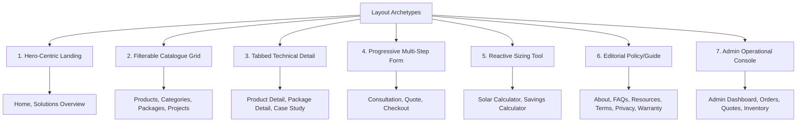

# DEVICE PRO — Stage 3: Sitemap, Wireframes & Content Plan

## 3.1 Overview and Purpose

Stage 3 translates the business requirements (Stage 1) and user journeys (Stage 2) into structural blueprints for the entire DEVICE PRO platform. This document establishes:
1. Complete Route Inventory and Information Architecture (62 total routes: 42 public + 20 admin).
2. Wireframes and section orders for all key page archetypes.
3. Content purpose, key messages, and missing content flags for every launch route.
4. Internal linking architecture and breadcrumb schema (guaranteeing zero dead-end pages).
5. Reusable UI layout archetypes.
6. Responsive behavior and breakpoint adaptation rules (Mobile, Tablet, Desktop).

---

## 3.2 Launch Sitemap & Route Inventory

### 3.2.1 Public Launch Routes

| # | Route | Page Title | Primary Goal | Template Archetype | Access |
|---|-------|------------|--------------|-------------------|--------|
| 1 | `/` | Home — DEVICE PRO Solar Solutions | Establish trust, route users to solutions, shop, or calculator | Hero-Centric Landing | Public |
| 2 | `/solutions` | Solar Solutions Overview | Help visitors identify their specific solar use case | Solution Directory | Public |
| 3 | `/solutions/residential` | Home & Residential Solar Systems | Provide home backup & off-grid packages & consult path | Solution Detail | Public |
| 4 | `/solutions/commercial` | Commercial & Business Solar Power | Address fuel generator displacement & ROI for business | Solution Detail | Public |
| 5 | `/solutions/industrial` | Industrial & High-Capacity Solar | Heavy 3-phase machinery, peak shaving & industrial reliability | Solution Detail | Public |
| 6 | `/solutions/infrastructure` | Solar Mini-Grids & Public Infrastructure | Rural mini-grids, telecom towers, institutions, streetlighting | Solution Detail | Public |
| 7 | `/products` | Solar Equipment Catalogue | Search, filter, and discover verified solar hardware | Filterable Catalogue Grid | Public |
| 8 | `/products/:slug` | Product Specification & Purchase | Technical specs, pricing, stock, warranty, add to cart / quote | Structured Detail | Public |
| 9 | `/categories/:slug` | Product Category Listing | Deep dive into specific hardware categories | Filterable Catalogue Grid | Public |
| 10 | `/packages` | Standard Solar Packages | Pre-engineered turnkey bundles (inverter + battery + PV) | Package Listing | Public |
| 11 | `/packages/:slug` | Solar Package Detail & Scope | Turnkey package scope, load capacity, inclusions/exclusions | Package Detail | Public |
| 12 | `/pricing` | Pricing Policy & Quotation Guide | Transparent pricing breakdown, installation cost factors | Content & Table | Public |
| 13 | `/projects` | Solar Installation Portfolio | Verified Nigerian case studies filtered by sector & capacity | Media Grid & Directory | Public |
| 14 | `/projects/:slug` | Installation Case Study | Project specs, engineering challenge, verified performance | Case Study Detail | Public |
| 15 | `/calculator` | Solar Sizing Calculator | Interactive appliance load assessment & system recommendation | Interactive Tool Engine | Public |
| 16 | `/savings-calculator` | Generator vs Solar Savings Estimator | Petrol/diesel displacement analysis and ROI estimate | Interactive Tool Engine | Public |
| 17 | `/financing` | Solar Financing Options | Payment plans, bank partnerships (marked placeholder until confirmed) | Informational & Guide | Public |
| 18 | `/resources` | Knowledge Centre & Solar Guides | Educational articles, maintenance tips, solar buyer guides | Article Directory | Public |
| 19 | `/resources/:slug` | Knowledge Guide Detail | Long-form technical guide with related solution CTAs | Editorial Reading | Public |
| 20 | `/faq` | Frequently Asked Questions | Categorized FAQs answering warranty, installation, battery types | Accordion Directory | Public |
| 21 | `/about` | About DEVICE PRO | Engineering credentials, mission, quality standards | Corporate Story | Public |
| 22 | `/team` | Engineering & Leadership Team | Certified solar engineers (flagged until profiles approved) | Profile Grid | Public |
| 23 | `/reviews` | Verified Client Testimonials | Real customer feedback (flagged until permissions approved) | Testimonial Grid | Public |
| 24 | `/locations` | Service & Installation Coverage | Confirmed Nigerian states/cities, hubs, delivery zones | Geographic Directory | Public |
| 25 | `/contact` | Contact & Inquiries | Direct inquiry form, email, verified phone numbers, office | Multi-channel Contact | Public |
| 26 | `/consultation` | Book an Engineering Consultation | Multi-step solar consultation request for bespoke setups | Multi-Step Form | Public |
| 27 | `/quote` | Request a Solar Quotation | Detailed quotation request with property & load specs | Multi-Step Form | Public |
| 28 | `/cart` | Shopping Cart | Review selected hardware, adjust quantities, verify shipping | E-Commerce Cart | Public |
| 29 | `/checkout` | Checkout & Payment | Shipping address, delivery calculation, Paystack payment | E-Commerce Checkout | Public / Guest |
| 30 | `/checkout/success` | Order Confirmation & Tracking | Order reference number, invoice download, dispatch steps | Transaction Status | Public / Tokenized |
| 31 | `/account` | Customer Dashboard | Overview of recent orders, active quotes, profile status | User Dashboard | Customer Auth |
| 32 | `/account/orders` | Customer Order History | Status tracking for hardware purchases and delivery | User Data Table | Customer Auth |
| 33 | `/account/quotes` | Customer Quote Requests | Status tracking for requested engineer proposals | User Data Table | Customer Auth |
| 34 | `/account/profile` | Customer Profile & Addresses | Shipping address, contact preferences, password security | Account Form | Customer Auth |
| 35 | `/support` | After-Sales Support & Service | Warranty claims, maintenance scheduling, service tickets | Service Directory | Public |
| 36 | `/privacy` | Privacy Policy | NDPR / data handling compliance, customer data rights | Legal & Policy | Public |
| 37 | `/terms` | Terms of Service | Commercial terms, ordering terms, dispute resolution | Legal & Policy | Public |
| 38 | `/delivery` | Shipping & Logistics Policy | Interstate freight, transit insurance, delivery windows | Legal & Policy | Public |
| 39 | `/returns` | Returns & Refund Policy | Defective equipment returns, testing protocol, RMA rules | Legal & Policy | Public |
| 40 | `/warranty` | Warranty Terms & Procedures | OEM vs workmanship warranty, claim submission guide | Legal & Policy | Public |
| 41 | `/accessibility` | Accessibility Statement | WCAG 2.1 AA commitments, keyboard support, feedback | Legal & Policy | Public |
| 42 | `/search` | Global Site Search Results | Unified search results across hardware, packages, guides | Search Results | Public |

### 3.2.2 Administration Routes (Protected Operations)

| # | Route | Page Title | Operational Purpose |
|---|-------|------------|---------------------|
| 43 | `/admin` | Admin Dashboard | Operational summary (orders, quote pipeline, inquiries, stock alerts) |
| 44 | `/admin/products` | Manage Products | Product catalogue CRUD, pricing updates, technical specifications |
| 45 | `/admin/categories` | Manage Categories | Product category and attribute schema management |
| 46 | `/admin/brands` | Manage Brands & OEMs | Manufacturer profiles, authorized distributor statuses |
| 47 | `/admin/packages` | Manage Solar Packages | Bundle definitions, bill-of-materials assignment, base pricing |
| 48 | `/admin/inventory` | Inventory & Stock Control | Stock levels, SKU reorder thresholds, warehouse locations |
| 49 | `/admin/orders` | Orders Management | Order fulfillment, Paystack transaction statuses, dispatch tracking |
| 50 | `/admin/payments` | Payment Reconciliation | Transaction audits, Paystack/bank transfer reference matching |
| 51 | `/admin/customers` | Customer Directory | Customer records, order history, contact details |
| 52 | `/admin/enquiries` | General Inquiries | Lead triage, customer response logging, WhatsApp/call dispatch |
| 53 | `/admin/quotes` | Quotation Pipeline | Sizing review, engineering estimate generation, PDF quote dispatch |
| 54 | `/admin/projects` | Case Studies & Portfolio | Verified project CRUD, image management, technical metric logs |
| 55 | `/admin/installations`| Installation Scheduling | Site visit scheduling, engineering dispatch, commissioning sign-off |
| 56 | `/admin/service` | After-Sales & RMA Tickets | Support tickets, warranty inspection reports, replacement tracking |
| 57 | `/admin/content` | Content & Knowledge Base | Guide publishing, FAQ updates, announcement banner controls |
| 58 | `/admin/promotions` | Discounts & Promotions | Promo codes, seasonal equipment campaigns, discount windows |
| 59 | `/admin/reports` | Business Analytics | Revenue, quotation conversion rate, top selling equipment reports |
| 60 | `/admin/users` | Staff & User Roles | Admin user management, RBAC (Administrator, Engineer, Support) |
| 61 | `/admin/settings` | Platform Settings | Business contact details, tax rate, Paystack API keys, maintenance |
| 62 | `/admin/audit-log` | System Audit Log | Immutable activity log of price changes, logins, order status shifts |

---

## 3.3 Wireframes & Structural Section Orders

### 3.3.1 Homepage (`/`) Wireframe
The homepage serves as the primary gateway, immediately clarifying DEVICE PRO's dual capability: pre-engineered hardware commerce and bespoke turnkey engineering.

```text
+------------------------------------------------------------------------------------+
| [ANNOUNCEMENT BAR] Nationwide Delivery & Accredited Installation Across Nigeria   |
+------------------------------------------------------------------------------------+
| [HEADER] LOGO   Solutions v   Products v   Packages   Calculator   Projects  About  |
|          [Search Bar]  [Cart (0)]  [Request a Quote CTA]                          |
+------------------------------------------------------------------------------------+
| [HERO SECTION]                                                                    |
|  Heading: Reliable Solar Power Engineered for Nigerian Homes & Businesses          |
|  Subheading: Tier-1 Inverters, Lithium Storage & Turnkey Solar Systems Designed to |
|              Permanently Replace Expensive Fuel Generators.                       |
|  [ Calculate Your System Sizing ] (Primary CTA)   [ Book Consultation ] (Secondary) |
|  [ Trust Badges: Tier-1 Hardware | Verified Warranties | Certified Engineers ]    |
+------------------------------------------------------------------------------------+
| [TRUST & CREDENTIAL STRIP]                                                        |
|  [ 100% Genuine OEM Hardware ]  [ 5-10 Year Battery Warranties ]  [ Nationwide Delivery ] |
+------------------------------------------------------------------------------------+
| [SOLUTION PATHWAYS - 4 CARDS]                                                      |
|  +--------------------+ +--------------------+ +--------------------+ +-----------+ |
|  | Residential Solar  | | Commercial Solar   | | Industrial Solar   | | Mini-Grid | |
|  | Homes, Estates, 3k | | SME, Offices, Fuel | | Factories, 3-Phase | | Telecom & | |
|  | [Explore Systems]  | | [Explore Systems]  | | [Explore Systems]  | | [Explore] | |
|  +--------------------+ +--------------------+ +--------------------+ +-----------+ |
+------------------------------------------------------------------------------------+
| [FEATURED PACKAGES & HARDWARE SPOTLIGHT]                                           |
|  [Tabs: Pre-Engineered Packages | Lithium Batteries | Hybrid Inverters | Panels]  |
|  +----------------------+ +----------------------+ +----------------------+      |
|  | 5kVA Lithium Package | | 10kVA Commercial Pkg | | 15kVA 3-Phase Package|      |
|  | NGN 4,200,000*       | | NGN 8,600,000*       | | NGN 14,800,000*      |      |
|  | [View Details & Scope] [View Details & Scope] [View Details & Scope]     |      |
|  +----------------------+ +----------------------+ +----------------------+      |
+------------------------------------------------------------------------------------+
| [INTERACTIVE SIZING CALCULATOR TEASER]                                             |
|  Heading: Don't Know What Size Solar System You Need?                             |
|  Visual preview of load calculator sliders & appliance selector                    |
|  [ Launch Interactive Sizing Calculator -> ]                                      |
+------------------------------------------------------------------------------------+
| [FEATURED VERIFIED CASE STUDIES / PROJECTS]                                       |
|  +--------------------------------+ +--------------------------------+             |
|  | Lekki Phase 1 Residential      | | Ikeja Industrial Cold Storage  |             |
|  | 15kVA Solar + 30kWh Lithium    | | 60kVA Hybrid PV Array + Diesel |             |
|  | [Read Engineering Case Study]  | | [Read Engineering Case Study]  |             |
|  +--------------------------------+ +--------------------------------+             |
+------------------------------------------------------------------------------------+
| [ENGINEERING EXCELLENCE: HOW DEVICE PRO WORKS (7 STEPS)]                           |
|  (1) Consult -> (2) Audit -> (3) Proposal -> (4) Contract -> (5) Install ->       |
|  (6) Commissioning & Testing -> (7) Lifetime Support                              |
+------------------------------------------------------------------------------------+
| [EDUCATIONAL RESOURCES & FAQ TEASER]                                              |
|  Top 4 Questions: Inverter Sizing, Lithium vs Tubular, Installation Warranty, Timelines|
+------------------------------------------------------------------------------------+
| [FINAL HIGH-CONVERSION CTA SECTION]                                               |
|  Heading: Ready to Eliminate Fuel Generator Costs?                                |
|  [ Request Custom Engineered Proposal ]   [ Chat with Solar Specialist on WhatsApp]|
+------------------------------------------------------------------------------------+
| [FOOTER] Company Profile | Direct Hardware | Solutions | Support | Legal Policies  |
+------------------------------------------------------------------------------------+
```

### 3.3.2 Solutions Overview (`/solutions`) & Detail Template (`/solutions/:slug`)
Unified design pattern for all 4 sectors: Residential, Commercial, Industrial, and Infrastructure.

```text
+------------------------------------------------------------------------------------+
| Breadcrumbs: Home > Solutions > Residential Solar Solutions                        |
+------------------------------------------------------------------------------------+
| [SOLUTION HERO]                                                                    |
|  Title: Clean, 24/7 Solar Electricity for Nigerian Homes & Estates                 |
|  Summary: Tailored inverter and lithium storage packages eliminating diesel noise,  |
|           protecting sensitive appliances, and securing uninterrupted power.       |
|  [ Request Residential Solar Proposal ]  [ Explore Home Packages ]                 |
+------------------------------------------------------------------------------------+
| [THE CHALLENGE & THE ENGINEERING SOLUTION]                                         |
|  Grid Instability & High Fuel Costs  vs  Quiet, Automated Solar + Storage ROI       |
+------------------------------------------------------------------------------------+
| [TYPICAL LOAD PROFILES & CAPACITY TIERS]                                           |
|  Tier 1: Essential Backup (1.5kVA - 3.5kVA) — Lighting, TVs, Fans, Fridge, WiFi    |
|  Tier 2: Full Household (5kVA - 10kVA) — Inverter ACs, Pumping Machines, Freezers   |
|  Tier 3: Luxury Estate (15kVA - 30kVA+) — Central AC, Water Treatment, Electric Gate|
+------------------------------------------------------------------------------------+
| [RECOMMENDED HARDWARE & PRE-ENGINEERED PACKAGES]                                   |
|  Grid of 3 matching standard packages with equipment breakdown & indicative cost   |
+------------------------------------------------------------------------------------+
| [CASE STUDIES IN THIS CATEGORY]                                                    |
|  Real installation highlights with system capacities and verified owner benefits   |
+------------------------------------------------------------------------------------+
| [7-STAGE PROJECT DELIVERY TIMELINE]                                                |
|  Site assessment -> Electrical audit -> CAD design -> Clean installation -> Testing|
+------------------------------------------------------------------------------------+
| [SOLUTION-SPECIFIC FAQS] (Accordion)                                               |
+------------------------------------------------------------------------------------+
| [IN-PAGE PROGRESSIVE CONSULTATION FORM]                                            |
|  Auto-selects 'Residential' in dropdown. Step 1: Contact | Step 2: Load / Budget   |
+------------------------------------------------------------------------------------+
```

### 3.3.3 Product Catalogue (`/products`) & Category Listing (`/categories/:slug`)

```text
+------------------------------------------------------------------------------------+
| Breadcrumbs: Home > Products > Inverters                                           |
+------------------------------------------------------------------------------------+
| [SEARCH & FILTER HEADER]                                                           |
|  Search Bar: [ Search inverters, batteries, solar panels, charge controllers...  ] |
|  Active Filters: [ Hybrid Inverters (X) ] [ 48V (X) ] [ Clear All ]               |
|  Sort By: [ Recommended v ] [ Price: Low-High ] [ Price: High-Low ] [ Capacity ]  |
+------------------------------------------------------------------------------------+
| [DESKTOP 2-COLUMN LAYOUT] (Mobile: Filters collapse into Slide-over Drawer)        |
|                                                                                    |
|  [LEFT SIDEBAR: FILTERS]           [RIGHT: PRODUCT GRID (3 Columns)]               |
|  - Category (Inverters, Batteries, +---------------------------------------------+ |
|    Panels, Charge Controllers)     | [PRODUCT CARD 1]                            | |
|  - Brand / OEM                     | Image + Brand Tag (e.g. Deye, Felicity)     | |
|  - System Voltage (12V, 24V, 48V)  | Product Title: 5kW 48V Hybrid Solar Inverter| |
|  - Inverter Output (kVA / kW)      | Specs Pill: 48V DC | Single Phase | 97.6% Eff |
|  - Battery Chemistry (LiFePO4)     | Price: NGN 1,450,000 (Incl. VAT)            | |
|  - In Stock Only [Toggle]          | Stock: [In Stock - Lagos Warehouse]         | |
|  - Price Range Slider (NGN)        | [ Add to Cart ]  [ Request Quote ]          | |
|                                    +---------------------------------------------+ |
|                                    | [PRODUCT CARD 2]                            | |
|                                    | 10.24kWh 51.2V LiFePO4 Wall Mount Battery   | |
|                                    | Price: NGN 2,850,000                        | |
|                                    | [ Add to Cart ]  [ Request Quote ]          | |
|                                    +---------------------------------------------+ |
+------------------------------------------------------------------------------------+
| [PAGINATION & RESULTS COUNT]                                                       |
|  Showing 1 - 12 of 48 verified hardware products   < Previous [ 1 ] 2  3  Next >   |
+------------------------------------------------------------------------------------+
```

### 3.3.4 Product Detail Page (`/products/:slug`)

```text
+------------------------------------------------------------------------------------+
| Breadcrumbs: Home > Products > Lithium Batteries > 10.24kWh 51.2V LiFePO4 Battery   |
+------------------------------------------------------------------------------------+
| [TOP SECTION: GALLERY & PURCHASE ACTIONS (2 COLUMNS)]                             |
|                                                                                    |
|  [LEFT: IMAGE GALLERY]             [RIGHT: HARDWARE SPEC & PURCHASE PANEL]         |
|  +-------------------------------+ Brand: Felicity Solar                           |
|  | High-Res Product Image        | Title: 10.24kWh 51.2V Wall-Mount Lithium Battery|
|  | (Zoom on hover)               | Model SKU: LPBF48200-P                          |
|  +-------------------------------+ Rating / Verified Tier-1 Cell Badge             |
|  [Thumb 1] [Thumb 2] [Thumb 3]    | Price: NGN 2,850,000 (Tax inclusive)           |
|                                    | Stock: In Stock (Lagos & Abuja Dispatch)       |
|                                    | Warranty: 5 Years Manufacturer Warranty        |
|                                    | Quantity: [-] [ 1 ] [+]                        |
|                                    | [ ADD TO CART ] (Primary Button)               |
|                                    | [ Request Engineering Quote with Installation ]|
|                                    | Verified Inclusions: Battery Cables, Mounting  |
+------------------------------------------------------------------------------------+
| [TABBED SPECIFICATION & DOCUMENTATION ENGINE]                                      |
|  [Tabs: Technical Specifications | Compatibility | Warranty & Returns | Delivery] |
|  - Usable Energy: 10.24 kWh                                                        |
|  - Nominal Voltage: 51.2 V                                                         |
|  - Chemistry: Lithium Iron Phosphate (LiFePO4)                                     |
|  - Cycle Life: >6,000 cycles @ 80% DoD                                             |
|  - BMS Inverter Comms: CAN / RS485 (Compatible with Deye, Sunsynk, Growatt, Victron)|
|  - Ingress Protection: IP65 Outdoor/Indoor Rated                                   |
+------------------------------------------------------------------------------------+
| [REQUIRED & COMPATIBLE ACCESSORIES]                                                |
|  - DC Disconnect Breaker Box   - Heavy Gauge Battery Cables   - Parallel Busbar    |
+------------------------------------------------------------------------------------+
| [RELATED SOLAR HARDWARE & BUNDLES]                                                 |
|  Matching 5kW/8kW Hybrid Inverters that pair seamlessly with this battery pack      |
+------------------------------------------------------------------------------------+
```

### 3.3.5 Packages & Pricing Overview (`/packages`, `/pricing`)

```text
+------------------------------------------------------------------------------------+
| Breadcrumbs: Home > Solar Packages & Pricing                                       |
+------------------------------------------------------------------------------------+
| [HEADER] Pre-Engineered Turnkey Solar Packages                                     |
|  Subheading: Fully specified bundles including Inverters, Lithium Storage, Solar   |
|              Panels, Balance of System (BoS), and Certified Installation.          |
|  Filter by Scale: [ All Packages ] [ Residential ] [ Commercial ] [ Off-Grid ]     |
+------------------------------------------------------------------------------------+
| [PACKAGE COMPARISON CARDS - 3 UP]                                                  |
|  +------------------------+ +------------------------+ +-------------------------+ |
|  | 3.5kVA Essential       | | 5kVA Premium Hybrid    | | 10kVA Commercial Trio   | |
|  | Best for 2-3 Bed Flats | | Best for 4-5 Bed Duplex| | Best for Clinics & SOHO | |
|  | Inverter: 3.5kW 24V    | | Inverter: 5kW 48V Pure | | Inverter: 10kW Hybrid   | |
|  | Storage: 5.12kWh Li    | | Storage: 10.24kWh Li   | | Storage: 20.48kWh Li    | |
|  | Panels: 4x 450W Mono   | | Panels: 8x 550W Tier-1 | | Panels: 16x 550W Mono   | |
|  | Installation: Standard | | Installation: Standard | | Installation: Heavy-Duty| |
|  | Price: NGN 2,750,000*  | | Price: NGN 4,650,000*  | | Price: NGN 8,900,000*   | |
|  | [View Full Package]    | | [View Full Package]    | | [View Full Package]     | |
|  +------------------------+ +------------------------+ +-------------------------+ |
+------------------------------------------------------------------------------------+
| [TRANSPARENT PRICING & INCLUSIONS POLICY]                                          |
|  Clear table distinguishing What Is Included (Hardware, DC wiring, Breakers, Labor)|
|  versus Site-Specific Exclusions (Civil foundation works, Roof replacement, Grid) |
+------------------------------------------------------------------------------------+
| [NEED A CUSTOM TAILORED CAPACITY?] -> [ Launch Solar Sizing Calculator ]           |
+------------------------------------------------------------------------------------+
```

### 3.3.6 Interactive Solar Sizing Calculator (`/calculator`)

```text
+------------------------------------------------------------------------------------+
| Breadcrumbs: Home > Tools > Solar Sizing Calculator                                |
+------------------------------------------------------------------------------------+
| [CALCULATOR CONTAINER - 3-STEP PROGRESSIVE WORKFLOW]                               |
|  Progress Stepper: (1) Select Appliances -> (2) Backup Hours -> (3) System Sizing  |
+------------------------------------------------------------------------------------+
| [STEP 1: APPLIANCE LOAD MATRIX]                                                    |
|  Category Selector: [ Living Room ] [ Kitchen ] [ Bedrooms ] [ Water / Pump ]      |
|                                                                                    |
|  Item                Qty    Rated Watts   Hours/Day   Simultaneous?                |
|  [x] LED Lighting    [ 10 ] [ 15W  ]      [ 8 hrs ]   [ Yes v ]                    |
|  [x] Smart TV 55"    [ 2  ] [ 120W ]      [ 6 hrs ]   [ Yes v ]                    |
|  [x] Inverter Fridge [ 1  ] [ 200W ]      [ 24 hrs]   [ Cyclic ]                   |
|  [x] 1.5HP InverterAC[ 2  ] [ 1100W]      [ 8 hrs ]   [ Peak Night ]               |
|  [x] 1HP Water Pump  [ 1  ] [ 750W ]      [ 1 hr  ]   [ Surge 2.2kW ]              |
|  [ + Add Custom Appliance ]                                                        |
+------------------------------------------------------------------------------------+
| [STEP 2: USAGE & BACKUP PREFERENCES]                                               |
|  - Desired Off-Grid Backup Autonomy: [ 12 Hours v ]                                |
|  - Grid Availability Profile: [ 4-8 Hours Grid per day v ]                         |
|  - Roof Space Available: [ Moderate Rooftop v ]                                    |
+------------------------------------------------------------------------------------+
| [STEP 3: REAL-TIME ENGINEERING SIZING OUTPUT (Instant Reactive Dashboard)]         |
|                                                                                    |
|  +-------------------------------------------------------------------------------+ |
|  | Peak Continuous Load: 3.45 kW | Peak Starting Surge: 6.8 kW                   | |
|  | Daily Energy Consumption: 16.4 kWh/day                                        | |
|  +-------------------------------------------------------------------------------+ |
|  | RECOMMENDED HARDWARE SIZING:                                                  | |
|  | * Inverter Minimum: 5.0 kVA / 5.0 kW (Pure Sine Wave 48V)                     | |
|  | * Battery Capacity: 15.0 kWh - 20.0 kWh LiFePO4 (80% Depth of Discharge)     | |
|  | * Solar Array Size: 4.4 kWp (8 x 550W Tier-1 Monocrystalline Panels)           | |
|  +-------------------------------------------------------------------------------+ |
|  | Matching Package: 5kVA Premium Hybrid Package (NGN 4,650,000*)                | |
|  |                                                                               | |
|  | [ Save This Calculation & Request Quotation ]   [ Download PDF Breakdown ]     | |
|  +-------------------------------------------------------------------------------+ |
|  *Disclaimer: Sizing estimate based on mathematical model. Final installation      |
|   design requires physical audit by a certified DEVICE PRO solar engineer.        |
+------------------------------------------------------------------------------------+
```

### 3.3.7 Savings Calculator: Generator vs Solar (`/savings-calculator`)

```text
+------------------------------------------------------------------------------------+
| Breadcrumbs: Home > Tools > Generator vs Solar Savings Calculator                  |
+------------------------------------------------------------------------------------+
| [INTERACTIVE COMPARISON INTERFACE]                                                 |
|                                                                                    |
|  [LEFT: CURRENT GENERATOR EXPENDITURE]  [RIGHT: SOLAR TRANSITION ESTIMATE]        |
|  - Generator Capacity: [ 7.5 kVA v ]   - Equivalent Solar System: 5kVA Hybrid      |
|  - Fuel Type: [ Petrol (PMS) v ]       - Estimated System Capital: NGN 4,650,000   |
|  - Daily Run Hours: [ 8 Hours slider ] - Annual Solar Maintenance: NGN 60,000     |
|  - Fuel Price (NGN/L): [ NGN 950/L ]                                               |
|  - Monthly Fuel Cost: NGN 342,000      - Monthly Solar Equivalent: NGN 5,000       |
|  - Monthly Servicing: NGN 25,000                                                   |
|  ------------------------------------  ------------------------------------------- |
|  Total Annual Gen Spend: NGN 4,404,000 - Estimated Break-Even Period: 13.5 Months  |
|                                        - 5-Year Net Fuel Savings: NGN 17,200,000   |
+------------------------------------------------------------------------------------+
| [ASSUMPTION TRANSPARENCY & ACCURACY DISCLOSURE]                                   |
|  Transparent formulas: Petrol consumption calculated at 1.5L/hr at 70% load.       |
|  Fuel inflation assumptions disclosed. No guaranteed financial promise made.       |
|  [ Get an Audited Energy Assessment from Our Engineers ]                          |
+------------------------------------------------------------------------------------+
```

### 3.3.8 Consultation & Quotation Multi-Step Forms (`/consultation`, `/quote`)

```text
+------------------------------------------------------------------------------------+
| Breadcrumbs: Home > Request a Solar Quotation                                      |
+------------------------------------------------------------------------------------+
| [FORM CONTAINER WITH PROGRESS INDICATOR]                                           |
|  Step 1: Contact Details -> Step 2: Site Location -> Step 3: Power Requirements    |
+------------------------------------------------------------------------------------+
| [STEP 1: CONTACT IDENTITY]                                                         |
|  Full Name: [ John Chukwuemeka                             ]                       |
|  Phone Number: [ +234 803 388 2268                         ] (Must be WhatsApp)    |
|  Email Address: [ john.c@example.com                       ]                       |
|  Contact Preference: (o) WhatsApp  ( ) Phone Call  ( ) Email                       |
+------------------------------------------------------------------------------------+
| [STEP 2: PROPERTY & GEOGRAPHY]                                                     |
|  State: [ Lagos State v ]     City / LGA: [ Lekki Phase 1, Eti-Osa ]               |
|  Property Type: [ Residential Duplex v ]   Roof Type: [ Metal Corrugated v ]       |
+------------------------------------------------------------------------------------+
| [STEP 3: ELECTRICAL LOADS & OBJECTIVE]                                             |
|  Target Budget (Optional): [ NGN 3M - 5M v ]                                       |
|  Primary Goal: [ Eliminate night generator noise & backup 2 ACs v ]                |
|  Upload Single Line Diagram / Energy Bill (Optional): [ Choose File ]              |
|  [x] I agree to DEVICE PRO's Privacy Policy and consent to contact regarding solar.|
+------------------------------------------------------------------------------------+
| [ACTION BUTTONS]                                                                   |
|  [ < Back ]               [ Submit Quotation Request -> ]                          |
+------------------------------------------------------------------------------------+
| [CONFIRMATION STATE / SUCCESS MODAL]                                               |
|  Success Icon: Quotation Request Received! Reference: #DP-Q-2026-0842              |
|  Next Steps: Senior Engineer assigned within 4 business hours.                     |
|  [ Track Quote Status ]  [ Chat with Lead Engineer Now on WhatsApp ]               |
+------------------------------------------------------------------------------------+
```

### 3.3.9 Cart, Checkout & Order Success (`/cart`, `/checkout`, `/checkout/success`)

```text
+------------------------------------------------------------------------------------+
| Breadcrumbs: Home > Shopping Cart                                                  |
+------------------------------------------------------------------------------------+
| [CART TABLE (2 COLUMNS: ITEMS LIST + ORDER SUMMARY)]                               |
|                                                                                    |
|  Hardware Item                Unit Price   Qty   Subtotal     Action               |
|  5kW 48V Hybrid Inverter      NGN 1,450,000 [ 1 ] NGN 1,450,000 [ Remove ]         |
|  10.24kWh LiFePO4 Battery     NGN 2,850,000 [ 1 ] NGN 2,850,000 [ Remove ]         |
|  Heavy Duty DC Cable Set      NGN    65,000 [ 2 ] NGN   130,000 [ Remove ]         |
|                                                                                    |
|  [ Continue Shopping ]                     [ORDER SUMMARY BOX]                     |
|                                            Item Total:       NGN 4,430,000         |
|                                            Estimated Freight: NGN    45,000        |
|                                            Total:            NGN 4,475,000         |
|                                            [ PROCEED TO CHECKOUT -> ]              |
+------------------------------------------------------------------------------------+
| [CHECKOUT: SHIPPING + PAYSTACK PAYMENT INTEGRATION]                                |
|  - Shipping Address: Full street, Landmark, City, State, Delivery Contact Phone    |
|  - Installation Add-on: [ ] Request Professional DEVICE PRO Installation (+Quote)  |
|  - Payment Method: (o) Paystack (Debit Card / USSD / Bank Transfer)                |
|                    ( ) Direct Bank Wire / Corporate Pro-Forma Invoice              |
|  [ Pay NGN 4,475,000 with Paystack ]                                               |
+------------------------------------------------------------------------------------+
```

### 3.3.10 Admin Operations Dashboard (`/admin/*`)

```text
+------------------------------------------------------------------------------------+
| [ADMIN TOPBAR] DEVICE PRO Operations | Search SKU/Orders | Admin User: Engr. Wale v|
+------------------------------------------------------------------------------------+
| [LEFT NAV]        | [MAIN OPERATIONAL WORKSPACE]                                   |
| - Dashboard       | Top Metric Tiles:                                              |
| - Products (CRUD) | [ Active Orders: 14 ] [ Pending Quotes: 8 ] [ Open Leads: 23 ] |
| - Solar Packages  |                                                                |
| - Inventory       | [QUOTATION QUEUE (Needs Engineering Review)]                   |
| - Orders          | Ref       Client            System Target   State   Status     |
| - Quotes Review   | #DP-Q-084 Adebayo Solar     10kVA Hybrid    Lagos   [Review]   |
| - Installations   | #DP-Q-083 Horizon Clinic    25kVA 3-Phase   Abuja   [Assigned] |
| - Service / RMA   |                                                                |
| - Content (CMS)   | [RECENT HARDWARE ORDERS & PAYSTACK STATUS]                     |
| - Audit Log       | Order ID  Customer          Amount (NGN)    Gateway Status     |
| - Settings        | #DP-ORD-1 Chief Okonkwo     4,475,000       SUCCESS [Dispatch] |
+------------------------------------------------------------------------------------+
```

---

## 3.4 Content Purpose & Missing Content Matrix

To uphold the core architectural rule: **"Never fabricate business data, prices, warranties, customer testimonials, certifications, or performance claims"**, every page has its verified vs unconfirmed content clearly separated.

| Route | Content Purpose | Primary User Goal | Verified Core Copy / Framework | Missing / Unconfirmed Content Flags |
|-------|-----------------|-------------------|--------------------------------|-------------------------------------|
| `/` (Home) | Commercial & engineering front door | Understand value proposition & start inquiry or purchase | 14-section architectural flow, technical explanations | ⚠️ Exact corporate registration, client logos, certified team headshots |
| `/solutions/*` | Explain problem, load profile & system architecture | Identify which setup matches their home/business | Electrical engineering logic, load breakdowns | ⚠️ Confirmed geographic installation radius by state |
| `/products` | Hardware store catalogue | Filter and locate verified equipment | Categories: Inverters, Batteries, Panels, Controllers | ⚠️ Final signed supplier pricing agreements & live stock numbers |
| `/products/:slug` | Technical decision & buying path | Review datasheet, check compatibility, buy or quote | Technical parameter schema (voltage, DoD, cycles) | ⚠️ Manufacturer high-res photo gallery clearance |
| `/packages` | Turnkey decision-making | Compare all-in-one solar systems | Clear separation of equipment vs install scope | ⚠️ Final turnkey bundle retail prices |
| `/calculator` | Self-service sizing calculation | Calculate exact required inverter and storage size | Transparent mathematical sizing algorithm | ⚠️ Engineer-approved regional solar irradiance factors |
| `/savings-calculator` | Economic justification | Calculate generator replacement payback | Fuel displacement formula (litres/hr * fuel price) | ⚠️ Real-time dynamic petrol/diesel pump price feeds |
| `/projects/*` | Proof of competence & execution | See real-world installations in Nigeria | Case study layout schema, technical metric cards | ⚠️ Owner-cleared photo releases and client names |
| `/about` | Corporate credibility & story | Verify company legitimacy and engineering background | Mission statement, quality standard guidelines | ⚠️ RC Number, CAC incorporation certificate copy |
| `/contact` | Multi-channel contact entry | Reach DEVICE PRO staff quickly | Contact form, service hours schema | ⚠️ Verified physical office address & direct WhatsApp line |
| `/warranty` | Legal & technical consumer assurance | Understand what happens if equipment fails | OEM warranty pass-through framework & RMA steps | ⚠️ Signed manufacturer service level agreements |
| `/delivery` | Logistics transparency across Nigeria | Know shipping times, freight costs & insurance | Interstate transport breakdown, inspection steps | ⚠️ Contracted logistics carrier rate cards (e.g. GIGL) |

---

## 3.5 Internal Linking & Navigational Flow Graph

### 3.5.1 Breadcrumb Hierarchy
All pages below level 1 follow strict breadcrumb navigation:
- `Home > Solutions > [Residential | Commercial | Industrial | Infrastructure]`
- `Home > Products > [Category] > [Product Name]`
- `Home > Packages > [Package Name]`
- `Home > Projects > [Project Name]`
- `Home > Resources > [Article Title]`
- `Home > Account > [Orders | Quotes | Profile]`

### 3.5.2 Cross-Linking Rules (Zero Dead-End Guarantee)
1. **From Solutions to Products & Packages**: Every solution detail page explicitly links to matching pre-engineered packages and recommended hardware components.
2. **From Calculator to Packages & Quote**: The sizing calculation output directly connects to the nearest matching turnkey package and pre-fills the quotation form.
3. **From Product Detail to Compatibility & Consultation**: Hardware items cross-link to matching accessories (e.g., battery to matching hybrid inverter) and provide a "Need Installation?" consultation link.
4. **From Case Studies to Solutions**: Each case study links to its parent solution category and the hardware bill of materials used in that project.
5. **From Every Informational Page to Conversion**: Every policy, article, and FAQ page terminates with a clear persistent conversion path (Quote Request or WhatsApp Specialist).

---

## 3.6 Reusable UI Layout Archetypes

To ensure code maintainability, efficiency, and consistency across the 62 routes, the frontend architecture relies on 7 reusable layout archetypes:



1. **Hero-Centric Landing Archetype**:
   - High-impact header + hero with dual CTA + trust strip + structured modular sections + final high-conversion banner.
2. **Filterable Catalogue Grid Archetype**:
   - Breadcrumbs + search header + active filter chips + desktop sidebar (mobile drawer) + 3-column responsive card grid + pagination.
3. **Tabbed Technical Detail Archetype**:
   - Media gallery + commercial purchase panel + sticky action bar on mobile + tabbed specifications/datasheets + compatible hardware carousel.
4. **Progressive Multi-Step Form Archetype**:
   - Step progress indicator + field validation groups + back/next navigation + persistence in sessionStorage + rich confirmation view with tracking ID.
5. **Reactive Sizing Tool Archetype**:
   - Appliance selection matrix + slider inputs + instant reactive calculation model + visual metric cards + export/quote action.
6. **Editorial Policy/Guide Archetype**:
   - Single-column readable text container (max-width 780px) + table of contents sidebar + deep heading hierarchy + print-friendly layout.
7. **Admin Operational Console Archetype**:
   - Collapsible admin sidebar + global search/user topbar + KPI summary tiles + data table with status badges and action dropdowns + slide-over CRUD drawers.

---

## 3.7 Responsive Behavior & Breakpoint Specifications

### 3.7.1 Breakpoints
- **Mobile (`<640px`)**: Single column flow, touch targets ≥48px, sticky bottom action bar for purchasing/consultation, full-screen overlay navigation drawer.
- **Tablet (`640px - 1023px`)**: 2-column grids for cards and form layouts, expandable filter accordions, horizontal scroll for data tables with shadow indicators.
- **Desktop (`≥1024px`)**: Full multi-column layouts (3-4 card grids), persistent sidebar filters, split-screen hero sections, visible desktop mega menu navigation.

### 3.7.2 Layout Adaptations by Component

| Component | Mobile (<640px) | Tablet (640px-1023px) | Desktop (≥1024px) |
|-----------|-----------------|-----------------------|-------------------|
| **Header Navigation** | Hamburger button -> Full-screen slide-in drawer | Compact header with search icon modal | Full horizontal menu with hover/click dropdowns |
| **Product Filters** | Floating "Filter" button -> Bottom slide-over sheet | Collapsible accordion top bar | Sticky left sidebar (width: 280px) |
| **Product Grid** | 1 column (or 2-column compact) | 2 columns | 3-4 columns |
| **Calculator UI** | Step-by-step vertical cards with bottom sticky summary | 2-column split (Inputs left, summary right) | Interactive 2-column layout with real-time reactive preview |
| **Detail Page Gallery**| Horizontal swipeable carousel with dot indicators | 2-column layout (gallery + buy box) | Sticky purchase box alongside expandable gallery |
| **Data Tables** | Stacked card view per record | Horizontally scrollable table container | Full wide table with inline sorting and action buttons |
| **Bottom Bar** | Sticky bottom conversion bar (Add to Cart / Request Quote) | Standard inline CTA buttons | Standard inline CTA buttons |

---

## 3.8 Stage 3 Verification & Gate Checklist

- [x] All 62 routes (42 public + 20 admin) accounted for with primary goals and templates.
- [x] Section order and wireframe blueprints established for all key pages.
- [x] Missing and unconfirmed business data explicitly catalogued and flagged with warnings.
- [x] Internal linking architecture guarantees zero dead-end pages.
- [x] 7 reusable page archetypes defined for code efficiency.
- [x] Responsive breakpoint behavior specified for mobile, tablet, and desktop.
- [x] Ready to proceed to visual styling and design system tokens (Stage 4).
