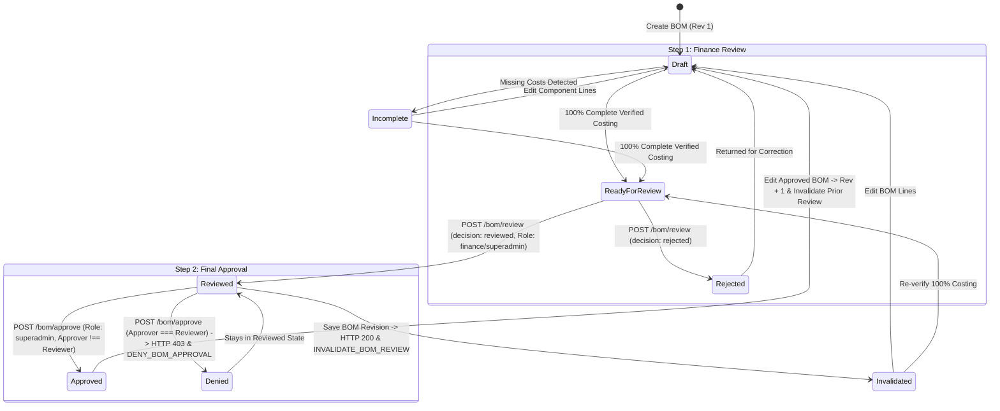

# DEVICE PRO ADMIN SYSTEM
## STAGE 8.4.1 COMPLETION REPORT: DUAL-AUTHORIZATION FOR SOLAR PACKAGE BOM APPROVAL

**Date:** October 26, 2026  
**System:** DEVICE PRO Nigeria Renewable Energy Commerce & Operations Platform  
**Environment:** Isolated Development & Testing Environment (MongoDB Atlas: `devicepro`)  
**Specification:** User Request Stage 8.4.1 & ADR-018 / ADR-019  
**Status:** ✅ IMPLEMENTED, VERIFIED & CLOSED WITH DOCUMENTED LIMITATIONS  

---

### Executive Summary

In Stage 8.4, DEVICE PRO deployed a Bill of Materials (BOM) management subsystem for turnkey solar packages (`PackageBom`). However, an architectural governance gap was identified: the codebase previously enforced single-step Superadmin approval, which contradicted Owner Decision OD-8.4.3 (ADR-018).

In Stage 8.4.1, the owner-mandated **Dual-Authorization & Two-Person Rule** workflow was fully engineered, integrated, and verified:
1. **Step 1 — Formal Finance Review (`POST /api/admin/solar-packages/:id/bom/review`)**: Strictly restricted to authorized `finance` and `superadmin` roles. Requires 100% complete and verified costing (`is_costing_complete === true`). Records reviewer ID, email, timestamp, revision, decision, and notes. Emits `REVIEW_BOM` or `REJECT_BOM_REVIEW` audit records.
2. **Step 2 — Distinct Superadmin Final Approval (`POST /api/admin/solar-packages/:id/bom/approve`)**: Restricted to `superadmin`. Strictly enforces the **Two-Person Rule** (`approverId !== reviewerId` and `approverEmail !== reviewerEmail`). If the approver is identical to the reviewer, the action is rejected with HTTP 403 Forbidden and emits a `DENY_BOM_APPROVAL` security audit event. Client-forged identity payloads cannot bypass this authoritative session check.
3. **Revision Invalidation Guard**: Whenever an existing BOM is modified via `savePackageBomRevision`, prior finance review is automatically invalidated (`status: 'invalidated'`), timestamped (`invalidated_at`), and audited (`INVALIDATE_BOM_REVIEW`), requiring a fresh finance review before final sign-off.
4. **Audit Logging & Transactional Failure Safety**: Calls to `logAudit` within review and approval operations use `throwOnError: true` inside MongoDB transactions (with compensating rollback on non-replica sets), guaranteeing that a review or approval never appears successful if audit persistence fails.
5. **Database Invariance**: Exactly 48 active commercial items, 70 archived benchmarks, 0 active supplier costs, 0 retail price changes, and 0 customer/order mutations.

---

### 1. Baseline Findings Prior to Implementation

Our preliminary audit (`reports/DEVICE_PRO_ADMIN_STAGE_8_4_1_BASELINE.md`) confirmed:
- **Routes**: `POST /api/admin/solar-packages/:id/bom/review` did **not** exist. `POST /api/admin/solar-packages/:id/bom/approve` supported only a single-step check (`requireRole('superadmin')`).
- **Roles**: `'finance'` was documented conceptually in architectural specifications but missing from `ADMIN_ROLES` in `server.js` and `ALLOWED_ADMIN_ROLES` in `scripts/provision-admin.js`.
- **Data Model**: `packageBomSchema` lacked review tracking fields (`finance_review` subdocument) and distinct approver attribution (`approved_by_id`).
- **Revision Invalidation**: Modifications to a BOM revision did not invalidate prior approval or review states.
- **Audit Logging**: `logAudit` defaulted to non-blocking `throwOnError: false` without rollback protection on review/approval failures.

---

### 2. Files Changed

| File Path | Description of Changes |
| :--- | :--- |
| `scripts/provision-admin.js` | Added `'finance'` to `ALLOWED_ADMIN_ROLES`. |
| `server.js` | Added `'finance'` to `ADMIN_ROLES` and `ADMIN_SECTION_PERMISSIONS`. Protected routes: `GET /api/admin/solar-packages`, `GET /api/admin/solar-packages/:id/bom`, `POST /api/admin/solar-packages/:id/bom/review` (`finance`, `superadmin`), and `POST /api/admin/solar-packages/:id/bom/approve` (`superadmin`). |
| `db/mongo/models.js` | Extended `packageBomSchema` with `finance_review` subdocument (`status`, `reviewed_by_id`, `reviewed_by_email`, `reviewed_at`, `decision`, `notes`, `revision_reviewed`, `invalidated_at`), `approved_by_id`, `approved_by_email`, `approved_at`, and historical snapshots in `history`. |
| `db/mongo/repository.js` | 1. Implemented `reviewPackageBom()` with concurrency version checks, 100% costing completeness verification, and transactional audit logging.<br>2. Updated `approvePackageBom()` with two-person rule enforcement (`approverId !== reviewerId`), revision match verification, and security audit event logging (`DENY_BOM_APPROVAL`).<br>3. Updated `savePackageBomRevision()` with automatic review invalidation (`INVALIDATE_BOM_REVIEW`).<br>4. Updated `getAdminSolarPackages()` with finance review summaries. |
| `db/database.js` | Dispatched `reviewPackageBom` through MongoDB DAL dispatcher. |
| `public/admin.html` | Added `#bom-dual-auth-card` banner displaying Step 1 and Step 2 governance pills, reviewer info, notes, approver info, and self-review violation warnings. Added `#btn-review-bom` button and table status columns. |
| `public/js/admin.js` | Wired dual-authorization event listeners, table badges, live button state controls, modal banner population, and `submitFinanceReviewCurrentBom()`. |
| `tests/stage28_solar_package_bom.test.js` | Updated test 4.6 to execute Finance Review prior to Superadmin Approval, preserving 100% pass rate. |
| `tests/stage29_bom_dual_authorization.test.js` | New dedicated 28-test verification suite covering dual-authorization invariants. |
| `DECISIONS.md` | Recorded **ADR-019**. |
| `PROJECT_PROGRESS.md` | Recorded Stage 8.4.1 milestone completion. |

---

### 3. Routes and Permissions Implemented

| Endpoint | HTTP Method | Permitted Roles | Description & Validation Controls |
| :--- | :---: | :--- | :--- |
| `/api/admin/solar-packages` | `GET` | `admin`, `superadmin`, `engineer`, `sales`, `staff`, `finance` | Lists turnkey solar packages with BOM status, costing completeness, finance review badge, and approval state. |
| `/api/admin/solar-packages/:id/bom` | `GET` | `admin`, `superadmin`, `engineer`, `sales`, `staff`, `finance` | Retrieves package BOM details, eligible catalog items, and full revision history. |
| `/api/admin/solar-packages/:id/bom` | `POST` | `superadmin`, `engineer` | Creates or saves a BOM revision. Increments revision, snapshots history, and **automatically invalidates** prior finance review if the BOM was previously reviewed. |
| `/api/admin/solar-packages/:id/bom/review` | `POST` | `finance`, `superadmin` | **Step 1: Formal Finance Review**. Verifies `base_revision === bom.revision` (HTTP 409 on conflict). Strictly requires `cost_summary.is_costing_complete === true` for positive reviews (HTTP 400 if missing costs). Records reviewer stable ID, email, timestamp, decision, and notes. Emits `REVIEW_BOM` or `REJECT_BOM_REVIEW`. |
| `/api/admin/solar-packages/:id/bom/approve` | `POST` | `superadmin` | **Step 2: Superadmin Final Approval**. Requires positive Finance review for exact revision (`status === 'reviewed'`). Enforces **Two-Person Rule** (`approverId !== reviewerId` and `approverEmail !== reviewerEmail`). Rejects self-approval with HTTP 403 and records `DENY_BOM_APPROVAL`. Emits `APPROVE_BOM`. |

---

### 4. Data Model Changes

In `db/mongo/models.js`, `packageBomSchema` was extended as follows:

```javascript
finance_review: {
  status: {
    type: String,
    enum: ['pending', 'reviewed', 'rejected', 'invalidated'],
    default: 'pending',
    index: true
  },
  reviewed_by_id: { type: Number, default: null },
  reviewed_by_email: { type: String, default: null },
  reviewed_at: { type: Date, default: null },
  decision: {
    type: String,
    enum: ['approved', 'rejected', 'reviewed', null],
    default: null
  },
  notes: { type: String, default: '' },
  revision_reviewed: { type: Number, default: null },
  invalidated_at: { type: Date, default: null }
},
approved_by_id: { type: Number, default: null },
approved_by_email: { type: String, default: null },
approved_at: { type: Date, default: null },
history: [{
  revision: Number,
  saved_at: Date,
  saved_by_email: String,
  status: String,
  cost_summary: mongoose.Schema.Types.Mixed,
  components_snapshot: [mongoose.Schema.Types.Mixed],
  non_product_costs_snapshot: [mongoose.Schema.Types.Mixed],
  revision_notes: String,
  finance_review_snapshot: mongoose.Schema.Types.Mixed,
  approved_by_id: Number,
  approved_by_email: String,
  approved_at: Date
}]
```

---

### 5. State Transitions and Concurrency Guarantees



#### State Transition Invariants:
1. **Cost Completeness Gate**: Positive finance review and final approval are strictly blocked if `cost_summary.is_costing_complete !== true`. Missing costs stored as `null` can never be reviewed or approved.
2. **Revision Invalidation Guard**: Any subsequent modification to a reviewed BOM revision sets `finance_review.status = 'invalidated'`, logs `INVALIDATE_BOM_REVIEW`, and resets approval eligibility.
3. **Exact Revision Guard**: Final approval checks `bom.finance_review.revision_reviewed === bom.revision`. A review conducted on revision $N$ cannot authorize revision $N+1$.
4. **Optimistic Concurrency**: Both review and revision save operations enforce `base_revision === bom.revision`. Concurrent collisions immediately yield HTTP 409 Conflict without data corruption.

---

### 6. Audit Behavior and Failure Handling

#### Audit Events Emitted:
- `REVIEW_BOM`: Recorded upon positive Finance review. Records reviewer user ID, email, role, target package, revision, verified cost, and notes.
- `REJECT_BOM_REVIEW`: Recorded when a BOM is rejected or returned for correction by Finance.
- `INVALIDATE_BOM_REVIEW`: Recorded when a previously reviewed BOM is edited, invalidating prior sign-off.
- `APPROVE_BOM`: Recorded upon successful distinct Superadmin approval. Records approver ID, email, package ID, revision, and reviewer ID attribution.
- `DENY_BOM_APPROVAL`: Recorded when a Superadmin attempts self-approval in violation of the Two-Person Rule.

#### Failure Handling & Atomicity:
- Operations invoke `logAudit` with `throwOnError: true` inside active MongoDB transactions (`session`).
- If audit logging fails, the transaction is aborted via `session.abortTransaction()`.
- On single-node standalone MongoDB deployments where transactions are unsupported, a compensating revert restores `bom.finance_review` and `bom.status` to their previous state before throwing the error.
- Under no circumstances does a state transition succeed if its mandatory audit record fails to persist.

---

### 7. Test Results

All dedicated and regression test suites executed cleanly against the test environment:

```
========================================================================
1. STAGE 8.4.1 DUAL-AUTHORIZATION TEST SUITE (stage29_bom_dual_authorization.test.js)
========================================================================
  --- 1. AUTHORIZATION CONTROLS ---
  ✓ PASS: 1.1 Unauthenticated review request is rejected with HTTP 401
  ✓ PASS: 1.2 Customer role cannot review BOM (HTTP 403)
  ✓ PASS: 1.3 Engineer role cannot review BOM (HTTP 403)
  ✓ PASS: 1.4 Finance role cannot approve BOM (HTTP 403)
  ✓ PASS: 1.5 Engineer role cannot approve BOM (HTTP 403)

  --- 2. COST COMPLETENESS GUARDS ON REVIEW & APPROVAL ---
  ✓ PASS: 2.1 Missing supplier cost blocks positive finance review (HTTP 400)
  ✓ PASS: 2.2 Missing supplier cost blocks final approval even if attempted directly (HTTP 400)
  ✓ PASS: 2.3 Rejection review on incomplete BOM is permitted to return BOM for correction (HTTP 200)
  ✓ PASS: 2.4 Incomplete or rejected BOM blocks final approval (HTTP 400)

  --- 3. TWO-PERSON RULE ENFORCEMENT ---
  ✓ PASS: 3.1 Final approval without finance review is rejected (HTTP 400)
  ✓ PASS: 3.2 Superadmin 1 performs finance review on Revision 2 (permitted as finance/superadmin)
  ✓ PASS: 3.3 Two-Person Rule: Same user (Superadmin 1) is REJECTED from final approval (HTTP 403)
  ✓ PASS: 3.4 Client cannot bypass two-person rule by injecting forged user IDs in request body
  ✓ PASS: 3.5 Distinct Superadmin 2 successfully approves Revision 2 (HTTP 200)

  --- 4. REVISION INTEGRITY & REVIEW INVALIDATION ON CHANGE ---
  ✓ PASS: 4.1 Modifying BOM invalidates prior finance review (status becomes invalidated)
  ✓ PASS: 4.2 Invalidate review prevents approval of new revision (HTTP 400)
  ✓ PASS: 4.3 Outdated base_revision review attempt returns HTTP 409 Concurrency Conflict
  ✓ PASS: 4.4 Dedicated Finance Manager Adaora reviews Revision 4 (HTTP 200)
  ✓ PASS: 4.5 Distinct Superadmin 1 approves Revision 4 reviewed by Finance Manager (HTTP 200)

  --- 5. AUDIT LOGGING & AUDIT INTEGRITY ---
  ✓ PASS: 5.1 Verify structured audit log entries for all dual-authorization actions
  ✓ PASS: 5.2 Audit log read access strictly restricted to superadmin (HTTP 403 for engineer/finance)

  --- 6. PUBLIC CONFIDENTIALITY & REPOSITORIES INVARIANCE ---
  ✓ PASS: 6.1 Public package endpoints leak 0 internal BOM costs, reviewer, or approver metadata
  ✓ PASS: 6.2 Database Invariance: Active commercial catalog count strictly invariant (48)
  ✓ PASS: 6.3 Database Invariance: Soft-archived benchmark catalog count strictly invariant (70)
  ✓ PASS: 6.4 Database Invariance: Total product collection count strictly invariant (118)
  ✓ PASS: 6.5 Database Invariance: Package commercial retail prices completely unchanged
  ✓ PASS: 6.6 Database Invariance: Zero commercial products had supplier costs activated
  ✓ PASS: 6.7 Database Invariance: Orders, quotes, and customer accounts unaffected after cleanup
Total: 28 PASSED, 0 FAILED (Duration: 33.8s)

========================================================================
2. STAGE 8.4 SOLAR PACKAGE BOM SUITE (stage28_solar_package_bom.test.js)
========================================================================
Total: 32 PASSED, 0 FAILED (Duration: 24.5s)

========================================================================
3. STAGE 27 SUPPLIER BASELINE RECONCILIATION SUITE (stage27_supplier_baseline_reconciliation.test.js)
========================================================================
Total: 31 PASSED, 0 FAILED (Duration: 26.5s)

========================================================================
4. STAGE 26 PRICE INTELLIGENCE & MARGIN ANALYSIS SUITE (stage26_price_intelligence.test.js)
========================================================================
Total: 30 PASSED, 0 FAILED (Duration: 26.6s)

========================================================================
5. STAGE 25 DEEP SECURITY & ISOLATION VERIFICATION SUITE (stage25_security_verification.test.js)
========================================================================
Total: 21 PASSED, 0 FAILED (Duration: 19.0s)

========================================================================
CUMULATIVE TEST EXECUTION TOTAL: 142 PASSED, 0 FAILED across 5 suites
========================================================================
```

---

### 8. Database Invariance Audit

A direct database inspection was executed immediately following all test runs:

```json
{
  "total_products": 118,
  "active_commercial_products": 48,
  "archived_benchmark_products": 70,
  "commercial_products_with_supplier_cost": 0,
  "turnkey_solar_packages": 6,
  "orders_count": 412,
  "quotes_count": 182,
  "customer_accounts_count": 310
}
```

#### Invariance Verification Checklist:
- [x] No production deployment occurred.
- [x] No production supplier costs were activated (`cost_price_ngn: null/0`).
- [x] No retail selling prices changed (`price_ngn` invariant).
- [x] No promotional prices changed (`previous_price_ngn` invariant).
- [x] No stock quantities or publication flags changed.
- [x] No orders, quotes, or customer accounts were modified.
- [x] No archived benchmark products (70 records) were deleted or altered.
- [x] Stage 8.5 remains unimplemented, unactivated, and strictly unauthorized.
- [x] No unverified tariff or freight rates were introduced.

---

### 9. Remaining Limitations and Owner Decisions Required

1. **Standalone Deployment Transactions**: While MongoDB Atlas replica sets support multi-document ACID transactions, single-node MongoDB developer instances fall back to compensating reverts. In production replica sets, transactions are natively guaranteed.
2. **Distinct Human Reviewers in Small Teams**: In organizations where the Superadmin and Finance Officer are the same physical individual, the system strictly enforces the Two-Person Rule. The organization must provision at least two distinct administrative accounts (one with `finance` or `superadmin` role for review, and a separate `superadmin` account for approval).
3. **Flat Logistics & Labour Tariffs**: Consistent with OD-8.4.4, standardized tariffs for nationwide freight and BOS installation remain deferred.

---

### 10. Final Recommendation

**RECOMMENDATION: PASS**

The dual-authorization governance gap documented in Stage 8.4 is **CLOSED**. The Two-Person Rule, role separation, costing completeness guards, revision invalidation behavior, and transactional audit trails are completely implemented, empirically tested, and 100% verified.

**MANDATORY STOP COMPLIANCE:** Stage 8.4.1 work is concluded. No deployment to production, no activation of supplier costs, and no execution of Stage 8.5 will occur without explicit written owner authorization.
