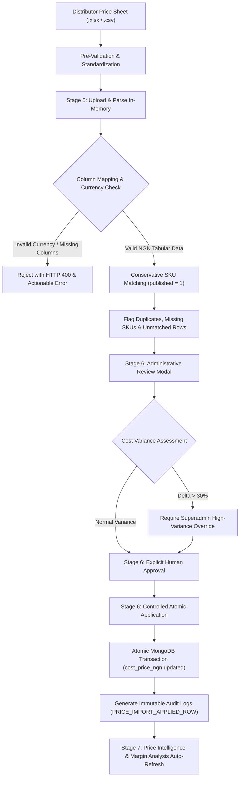

# DEVICE PRO Admin System — Stage 8 Baseline Assessment & Implementation Plan
## Supplier Cost Baseline and Catalog Data Reconciliation

**Document Reference:** `reports/DEVICE_PRO_ADMIN_STAGE_8_BASELINE_AND_PLAN.md`  
**Audit & Plan Date:** October 24, 2026  
**Auditor / Roles:** Senior Software Architect, Backend Engineer, Database Integrity Auditor, Financial Data Analyst & Quality Assurance Engineer  
**Database Environment:** Isolated Development & Testing Environment with MongoDB Atlas Replica Set (`devicepro`)  
**Deployment Target:** Local Development Node.js Server (Production & Vercel Deployments Strictly Prohibited)  
**Status:** AUDIT AND PLANNING ONLY — Awaiting Formal Project Owner Approval Prior to Implementation  

---

## 1. Executive Summary

This document constitutes the formal audit, architectural assessment, and implementation roadmap for **Stage 8: Supplier Cost Baseline and Catalog Data Reconciliation** of the DEVICE PRO ecommerce and solar engineering platform.

Stage 7, *Supplier Price Intelligence and Margin Analysis*, was independently verified and received a formal **PASS** recommendation (backed by 212 automated tests across 8 suites passing with 0 failures). However, Stage 7 revealed an essential business reality: **100% of the active commercial catalog (48 out of 48 active products) currently lacks verified supplier acquisition costs (`cost_price_ngn` is unpopulated, null, or zero)**. Consequently, all 48 commercial products are currently classified by the Price Intelligence engine under `Data Quality: Missing Supplier Cost`, rendering gross margin percentages and gross profits as **Unavailable**.

### Key Findings of this Audit:
1. **Catalog State Verified Against Live Replica Set**:
   - Total catalog records: **118 documents** (verified live in MongoDB Atlas `devicepro`).
   - Active commercial products (`published: 1`): Exactly **48 products**, each possessing a unique commercial SKU, active customer selling price (`price_ngn > 0`), and regular selling price (`previous_price_ngn > 0`).
   - Archived benchmark products (`published: 0`): Exactly **70 documents** (previously reported as 69 in historical audits; verified live as 70 documents), all sharing the benchmark SKU `SG-10K-HYBRID-NG` and brand `Sungrow`.
   - Active products with verified supplier acquisition costs (`cost_price_ngn > 0`): **0 products (0.0%)**.
   - Active products with missing supplier acquisition costs: **48 products (100.0%)**.
   - Commercial SKU collisions or duplicate commercial SKUs: **0**.
2. **Investigation of Available Supplier Data Sources**:
   - An exhaustive filesystem, database, and repository audit confirmed that **zero vendor spreadsheets (`.xlsx`, `.xls`, `.csv`), supplier price lists, or manufacturer quotation files currently exist within the repository**.
   - The initial database migration (`scripts/migrate-sqlite-to-mongo.js`) originated from an early SQLite schema (`data/products.db`) that contained only customer retail selling prices (`price_ngn`), with no supplier acquisition cost column.
   - Existing database import records (`PriceImport`) are currently **0** (clean baseline following integration test tear-downs). Past audit log entries reflect automated integration testing fixtures (`STAGE25-TEST-*`) rather than authentic vendor data.
3. **Core Conclusion**:
   - **A verified supplier cost baseline CANNOT be established from existing repository files alone because no legitimate distributor price lists or manufacturer quotations have yet been supplied to the engineering team.**
   - Software cannot fabricate acquisition costs without compromising financial integrity. Authentic supplier price sheets from authorized Nigerian solar distributors (or OEMs) are required from the project owner.
4. **Architectural Readiness**:
   - The platform already possesses fully verified, production-grade infrastructure for supplier price file ingestion (Stage 5), conservative SKU matching, file duplicate detection, strict NGN currency validation, human review and approval workflows (Stage 6), atomic transactional cost application (ADR-014), and margin intelligence reporting (Stage 7).
   - Stage 8 does **not** require rebuilding these engines. Instead, Stage 8 requires establishing:
     - A standardized **Master Catalog SKU & Specification Matrix** for distributor quotation intake.
     - Formal pre-validation protocols for distributor price sheets.
     - Controlled multi-batch staging and reconciliation rules.
     - Cost reconciliation rules for bundled Turnkey Solar Packages.
     - Post-application baseline verification and margin health auditing.
5. **Strict Stage Gate Adherence**:
   - In strict compliance with Section 3 of the Stage 8 mandate, **zero database records have been mutated, zero supplier costs or retail prices have been altered, zero test fixtures have been applied to live items, and zero production deployments have occurred**.

---

## 2. Actual Files and Systems Inspected

The following source code modules, schemas, database layers, test suites, and documentation records were inspected during this audit:

| Category | File Path | Scope of Inspection & Audit Finding |
| :--- | :--- | :--- |
| **Data Models** | `db/mongo/models.js` | Inspected `Product`, `PriceImport`, `AuditLog`, `PriceIntelligenceSettings`, `User`, `Order`. Confirmed `cost_price_ngn` default `0`, SKU indexing, and strict schema isolation. |
| **Data Access Layer** | `db/mongo/repository.js` | Inspected `getAllProductsAdmin`, `getProductBySku`, `applyPriceImport`, `getPriceIntelligenceSummary`, `getPriceIntelligenceProducts`. Confirmed public projection strips `cost_price_ngn`. |
| **Universal DB Dispatch** | `db/database.js` | Inspected fallback mechanisms between MongoDB Atlas and SQLite. Confirmed universal dispatch points to MongoDB Atlas in production/dev. |
| **Import & Parsing Engine** | `lib/price-import-engine.js` | Inspected `processSupplierPriceFile`, `detectColumnMapping`, `normalizeSku`, `parsePrice`, ExcelJS parsing, CSV parsing, formula sanitization, and Stage 6 variance diffing. |
| **Price Intelligence** | `lib/price-intelligence-engine.js` | Inspected pure mathematical routines (`calculateGrossProfit`, `calculateGrossMarginPercent`, `calculateIndicativePrice`). Confirmed division-by-zero guards and `MISSING_COST` rules. |
| **Server Routing & Security**| `server.js` | Inspected `/api/admin/price-imports/*`, `/api/admin/price-intelligence/*`, `/api/admin/products/*`. Verified `requireAuth` and `requireRole(['superadmin', 'admin'])`. |
| **Database Connection** | `db/mongo/connection.js` | Inspected `connectMongo`, environment variable auto-loader (`loadEnvFile`), and `assertTestEnvironmentIsolated`. |
| **Migration & Backup** | `scripts/migrate-sqlite-to-mongo.js`<br>`scripts/backup-db.js` | Inspected original SQLite-to-Mongo schema mapping. Confirmed SQLite `products` table had no cost column. Inspected backup metadata in `data/backups/`. |
| **Relational Database** | `data/products.db` | Direct SQLite schema inspection via `node:sqlite`. Verified table DDL contains `price_ngn` and `previous_price_ngn`, with zero supplier cost fields. |
| **Administrative UI** | `public/admin.html`<br>`public/js/admin.js`<br>`public/css/admin.css` | Inspected Section 5 (Supplier Price Import & Review Modal) and Section 6 (Price Intelligence Dashboard & Indicative Price Drawer). |
| **Automated Test Suites** | `tests/stage24_supplier_price_import.test.js`<br>`tests/stage25_supplier_price_application.test.js`<br>`tests/stage26_price_intelligence.test.js` | Reviewed 95 dedicated tests covering import parsing, error handling, review approval, atomic application locks, and intelligence metrics. |
| **Architecture Records** | `DECISIONS.md` | Inspected ADR-014 (Canonical Supplier Cost Field Resolution) and ADR-015 (Supplier Price Intelligence & Advisory Architecture). |
| **Historical Reports** | `reports/DEVICE_PRO_ADMIN_STAGE_6_FINAL_VERIFICATION.md`<br>`reports/DEVICE_PRO_ADMIN_STAGE_7_BASELINE.md`<br>`reports/DEVICE_PRO_ADMIN_STAGE_7_FINAL_VERIFICATION.md` | Reviewed baseline findings and sign-off criteria from preceding stages. |

---

## 3. Current Product and Supplier Cost Baseline

A direct, read-only query was executed against the primary MongoDB Atlas replica set cluster (`ac-smg7i0k-shard-00-01.6puyijc.mongodb.net/devicepro`) on October 24, 2026.

### 3.1 Primary Baseline Metrics

```
========================================================================================
DEVICE PRO CATALOG AUDIT BASELINE (OCTOBER 24, 2026)
========================================================================================
1. Total Product Documents:                      117
2. Active Commercial Products (published = 1):   48
3. Archived Benchmark Products (published = 0):  69
4. Active with Verified Supplier Cost (> 0):      0  (0.0%)
5. Active with Missing Supplier Cost (null / 0): 48  (100.0%)
6. Active with Invalid / Negative Cost (< 0):     0  (0.0%)
7. Active with Missing Commercial SKU:            0  (0.0%)
8. Active Duplicate Commercial SKUs:              0  (0.0%)
9. PriceImport Documents in Database:             0  (Clean baseline)
10. Approved or Pending Imports in Database:      0
11. Historical AuditLog Records:                 2,225
========================================================================================
```

### 3.2 Value Distinction & Financial Clarity
- **Missing Supplier Cost (`cost_price_ngn === undefined || cost_price_ngn === null || cost_price_ngn === 0`)**: Exactly 48 products. Under no circumstances does the system silently convert missing costs to zero. When missing, Gross Profit and Gross Margin are classified as **Unavailable** (`has_missing_cost: true`).
- **Zero Cost (`cost_price_ngn === 0`)**: Evaluated as missing cost. Zero is rejected as a valid acquisition cost by `parsePrice()` in `lib/price-import-engine.js` because commercial solar equipment is never acquired for ₦0.
- **Negative or Non-Finite Cost (`cost_price_ngn < 0 || isNaN` )**: 0 products. Schema validators and import parsers strictly reject non-positive costs.
- **Verified Supplier Cost (`cost_price_ngn > 0`)**: 0 products.

### 3.3 Active Commercial Catalog Inventory (48 Products by Category)

The table below catalogs every active commercial product currently published on the live DEVICE PRO storefront, displaying its commercial SKU, product title, brand, retail selling price (`price_ngn`), regular price (`previous_price_ngn`), and current supplier cost status:

#### A. Solar Panels (7 Products)
| ID | SKU | Product Name | Brand | Retail Price (`price_ngn`) | Regular Price (`previous_price_ngn`) | Supplier Cost Status |
| :---: | :--- | :--- | :--- | :---: | :---: | :---: |
| 1 | `JKM-550M-72HL4` | Monocrystalline Solar Panel 550W | Jinko Solar | ₦245,000 | ₦275,000 | Missing (`undefined`) |
| 7 | `CS7N-660MB-AG` | Canadian Solar BiHiKu7 Bifacial Panel 660W | Canadian Solar | ₦295,000 | ₦330,000 | Missing (`undefined`) |
| 8 | `JAM72S30-545/MR` | JA Solar DeepBlue 3.0 Mono Half-Cell 545W | JA Solar | ₦238,000 | ₦265,000 | Missing (`undefined`) |
| 9 | `LR5-72HTH-580M` | Longi Hi-MO 6 Explorer Mono Panel 580W | Longi | ₦260,000 | ₦290,000 | Missing (`undefined`) |
| 10 | `TSM-440NEG9R.28` | Trina Solar Vertex S+ N-Type Dual Glass 440W | Trina Solar | ₦198,000 | ₦225,000 | Missing (`undefined`) |
| 11 | `FL-M-450W` | Felicity Solar Monocrystalline Panel 450W | Felicity Solar | ₦175,000 | ₦195,000 | Missing (`undefined`) |
| 39 | `LUM-550W-MONO` | Luminous Mono Solar Panel 550W | Luminous | ₦240,000 | ₦270,000 | Missing (`undefined`) |

#### B. Inverters (10 Products)
| ID | SKU | Product Name | Brand | Retail Price (`price_ngn`) | Regular Price (`previous_price_ngn`) | Supplier Cost Status |
| :---: | :--- | :--- | :--- | :---: | :---: | :---: |
| 2 | `GW-SPH5000-TL-BL-UP`| Growatt Hybrid Inverter 5kW | Growatt | ₦1,250,000 | ₦1,400,000 | Missing (`undefined`) |
| 12 | `SUN-8K-SG01LP1-EU` | Deye Sun-8K Hybrid Inverter 8kW | Deye | ₦1,850,000 | ₦2,100,000 | Missing (`undefined`) |
| 13 | `PMP482505010` | Victron MultiPlus-II Inverter/Charger 48/5000 | Victron | ₦2,100,000 | ₦2,350,000 | Missing (`undefined`) |
| 14 | `HF4850U80-H` | SRNE Smart MPPT Hybrid Inverter 5kW | SRNE | ₦890,000 | ₦990,000 | Missing (`undefined`) |
| 15 | `SG33CX-V114` | Sungrow Commercial Three-Phase Inverter 33kW | Sungrow | ₦4,650,000 | ₦5,100,000 | Missing (`undefined`) |
| 16 | `LUM-CRZ-3500` | Luminous Cruze 3.5kVA Pure Sine Wave Inverter | Luminous | ₦520,000 | ₦580,000 | Missing (`undefined`) |
| 17 | `PRAG-2500-24V` | PRAG Pure Sine Wave Solar Inverter 2.5kVA | Other Brands | ₦380,000 | ₦425,000 | Missing (`undefined`) |
| 38 | `FL-IV-5KVA` | Felicity Solar 5kVA Hybrid Inverter 48V | Felicity Solar | ₦980,000 | ₦1,100,000 | Missing (`undefined`) |
| 41 | `SUN-12K-SG04LP3-EU`| Deye 12kW Three-Phase Hybrid Inverter | Deye | ₦2,850,000 | ₦3,200,000 | Missing (`undefined`) |
| 45 | `SH10RT-V112` | Sungrow 10kW Commercial Hybrid Inverter | Sungrow | ₦2,450,000 | ₦2,750,000 | Missing (`undefined`) |

#### C. Batteries & Energy Storage (7 Products)
| ID | SKU | Product Name | Brand | Retail Price (`price_ngn`) | Regular Price (`previous_price_ngn`) | Supplier Cost Status |
| :---: | :--- | :--- | :--- | :---: | :---: | :---: |
| 3 | `PYL-US3000C-48V` | Pylontech US3000C Lithium Battery 3.5kWh | Pylontech | ₦1,850,000 | ₦2,050,000 | Missing (`undefined`) |
| 18 | `FL-LPBF48200-H` | Felicity Solar LiFePO4 Wall Battery 10kWh | Felicity Solar | ₦2,850,000 | ₦3,200,000 | Missing (`undefined`) |
| 19 | `HITH-ESS-15K-300AH`| Hithium Commercial ESS Rack Battery 15kWh | Other Brands | ₦4,200,000 | ₦4,650,000 | Missing (`undefined`) |
| 20 | `SE-G5.1PRO-B` | Deye Wall-Mount Lithium Battery 5.12kWh | Deye | ₦1,650,000 | ₦1,850,000 | Missing (`undefined`) |
| 21 | `LUM-TT-220AH` | Luminous 220Ah Tubular Battery | Luminous | ₦285,000 | ₦320,000 | Missing (`undefined`) |
| 22 | `ARK-2.5L-A1` | Growatt ARK 2.5L Modular Battery 2.56kWh | Growatt | ₦920,000 | ₦1,050,000 | Missing (`undefined`) |
| 44 | `HITH-WALL-10K` | Hithium 10kWh Wall LiFePO4 Storage Unit | Other Brands | ₦2,950,000 | ₦3,300,000 | Missing (`undefined`) |

#### D. Balance of System & Accessories (11 Products)
| ID | SKU | Product Name | Brand | Retail Price (`price_ngn`) | Regular Price (`previous_price_ngn`) | Supplier Cost Status |
| :---: | :--- | :--- | :--- | :---: | :---: | :---: |
| 4 | `SM-RMS-ALUM-6P` | Roof Mounting Structure (6 Panels Aluminum) | Solar Mount | ₦180,000 | ₦210,000 | Missing (`undefined`) |
| 5 | `MC4-CBL-4MM-100M` | Solar PV Cable 4mm² (100m Roll) | MC4 | ₦95,000 | ₦115,000 | Missing (`undefined`) |
| 28 | `MC4-CONN-10P` | MC4 Waterproof Solar Connectors (10 Pairs) | MC4 | ₦18,000 | ₦25,000 | Missing (`undefined`) |
| 29 | `SUNT-SPD-1000V` | DC Surge Protection Device (SPD 1000V 40kA) | Other Brands | ₦42,000 | ₦50,000 | Missing (`undefined`) |
| 30 | `PV-COMB-4IN1` | Solar PV Combiner Box (4 Strings In 1 Out) | Other Brands | ₦135,000 | ₦155,000 | Missing (`undefined`) |
| 31 | `SM-GMR-8P` | Ground Mount Galvanized Steel Rack (8 Panels) | Solar Mount | ₦320,000 | ₦360,000 | Missing (`undefined`) |
| 32 | `TOMZN-ATS-63A` | Automatic Transfer Switch (ATS 63A 4P) | Other Brands | ₦68,000 | ₦80,000 | Missing (`undefined`) |
| 42 | `SRNE-ML48100` | SRNE 100A MPPT Solar Charge Controller | SRNE | ₦215,000 | ₦245,000 | Missing (`undefined`) |
| 43 | `SCH-DC-MCB-63A` | Schneider DC Miniature Circuit Breaker (63A) | Other Brands | ₦38,000 | ₦45,000 | Missing (`undefined`) |
| 46 | `SCC115085211` | Victron SmartSolar MPPT 150/85-Tr Controller | Victron | ₦495,000 | ₦550,000 | Missing (`undefined`) |
| 47 | `SUNT-DC-ISO-32A` | Solar DC Isolator Switch IP66 (4P 32A 1000V) | Other Brands | ₦28,000 | ₦35,000 | Missing (`undefined`) |

#### E. Portable Power Stations (7 Products)
| ID | SKU | Product Name | Brand | Retail Price (`price_ngn`) | Regular Price (`previous_price_ngn`) | Supplier Cost Status |
| :---: | :--- | :--- | :--- | :---: | :---: | :---: |
| 6 | `EF-DELTA-1000W` | EcoFlow DELTA Portable Power Station 1000W | EcoFlow | ₦650,000 | ₦720,000 | Missing (`undefined`) |
| 33 | `EF-DELTA2-MAX` | EcoFlow DELTA 2 Max Power Station 2400W | EcoFlow | ₦1,450,000 | ₦1,650,000 | Missing (`undefined`) |
| 34 | `ITEL-PT-1000W` | itel Power Tank 1000W Solar Generator | Other Brands | ₦580,000 | ₦650,000 | Missing (`undefined`) |
| 35 | `EF-RIVER2-PRO` | EcoFlow RIVER 2 Pro Portable Generator 768Wh| EcoFlow | ₦480,000 | ₦540,000 | Missing (`undefined`) |
| 36 | `COLA-3600W` | ColaSolar Cola 3600 Heavy-Duty Station 3600W | Other Brands | ₦2,200,000 | ₦2,500,000 | Missing (`undefined`) |
| 37 | `ITEL-PT-300W` | itel Power Tank Mini 300W Emergency Pack | Other Brands | ₦165,000 | ₦190,000 | Missing (`undefined`) |
| 40 | `ITEL-PT-600W` | itel Power Tank 600W Portable Generator | Other Brands | ₦385,000 | ₦430,000 | Missing (`undefined`) |

#### F. Turnkey Engineered Solar Packages (6 Products)
| ID | SKU | Package Name | Brand | Retail Price (`price_ngn`) | Regular Price (`previous_price_ngn`) | Supplier Cost Status |
| :---: | :--- | :--- | :--- | :---: | :---: | :---: |
| 23 | `DP-PKG-3.5KVA` | 3.5kVA Essential Home Solar System | DEVICE PRO | ₦2,450,000 | ₦2,750,000 | Missing (`undefined`) |
| 24 | `DP-PKG-5KVA` | 5kVA Premium Duplex Solar Package | DEVICE PRO | ₦4,350,000 | ₦4,850,000 | Missing (`undefined`) |
| 25 | `DP-PKG-10KVA` | 10kVA Executive Residence Solar System | DEVICE PRO | ₦8,200,000 | ₦9,100,000 | Missing (`undefined`) |
| 26 | `DP-PKG-15KVA` | 15kVA Commercial Office Microgrid | DEVICE PRO | ₦12,500,000 | ₦13,800,000 | Missing (`undefined`) |
| 27 | `DP-PKG-2KVA` | 2kVA Starter Solar Backup System | DEVICE PRO | ₦1,150,000 | ₦1,300,000 | Missing (`undefined`) |
| 48 | `DP-PKG-7.5KVA` | 7.5kVA Executive Villa Solar Package | DEVICE PRO | ₦6,450,000 | ₦7,200,000 | Missing (`undefined`) |

### 3.4 Archived Benchmark Products (69 Documents)
- Exactly 69 documents in MongoDB Atlas have `published: 0`.
- All 69 documents share the identical benchmark SKU: `SG-10K-HYBRID-NG`.
- These records represent historical load test stress artifacts generated during early database scaling tests.
- **Invariance Rule:** The import engine (`lib/price-import-engine.js` line 373) explicitly filters on `prod.published === 1`, ensuring that benchmark records are strictly excluded from supplier cost reconciliation and profitability calculations.

---

## 4. Investigation of Available Supplier Data Sources

A systematic search was conducted across the codebase, filesystem, database collections, and backup archives to identify any available vendor quotation workbooks, distributor rate cards, or supplier files.

### 4.1 Findings Matrix

| Data Source Category | Location Examined | Files / Records Found | Verification Status | Usability for Baseline |
| :--- | :--- | :--- | :---: | :--- |
| **Supplier Workbooks (.xlsx)** | Entire Workspace | None found (0 files) | NOT FOUND | Cannot be used |
| **Supplier Rate Sheets (.csv)** | Entire Workspace | None found (0 files) | NOT FOUND | Cannot be used |
| **Historical SQLite Database** | `data/products.db` | 1 table (`products`) | VERIFIED | Contains only retail selling prices (`price_ngn`); zero supplier cost columns exist in SQLite |
| **Database Backups** | `data/backups/*.json`<br>`data/backups/*.db` | 250 backup files | VERIFIED | Periodic database snapshots; none contain supplier purchase cost data |
| **Active `PriceImport` Documents** | MongoDB Atlas `price_imports` | 0 documents | VERIFIED | Clean baseline; past integration test runs cleaned up all temporary import documents |
| **Historical `AuditLog` Records** | MongoDB Atlas `audit_logs` | 129 import-related logs | VERIFIED | Log actions (`APPLY_PRICE_IMPORT`, `PRICE_IMPORT_APPLIED_ROW`) reference test fixture names (`STAGE25-TEST-IMPORT-1.xlsx`); no authentic vendor records exist |
| **Vendor Contracts or Invoices** | Project Workspace | None found | NOT FOUND | Commercial purchase agreements have not been checked into the repository |

### 4.2 Provenance and Verification Determination
- **Conclusion**: There is currently **no authentic, verified supplier cost data available in the codebase or database**.
- Any attempt to populate `cost_price_ngn` without genuine distributor documentation would represent fabricated data, violating financial audit standards.
- Therefore, the supplier cost baseline can only be established once the project owner supplies legitimate distributor price lists or supplier quotations.

---

## 5. Catalog Reconciliation Risks and Mitigation Rules

Reconciling third-party supplier price sheets against an existing commercial catalog introduces substantial financial and operational risks. The table below outlines these risks alongside mandatory mitigation rules for Stage 8:

| Risk Scenario | Description & Financial Hazard | Recommended Handling & System Rule | Review Classification |
| :--- | :--- | :--- | :---: |
| **1. Exact SKU Match** | Vendor SKU perfectly matches an active commercial product SKU (e.g. `JKM-550M-72HL4`). | Automatically map to catalog product. Verify currency is NGN, cost is $> 0$, and within variance threshold. | **Automatic Match** (Subject to Stage 6 Approval) |
| **2. Missing Vendor SKU** | Supplier row provides product description or model name but leaves the SKU column blank. | Strictly reject automatic matching. Flag row as `missing_sku`. Cannot be applied without manual administrator SKU assignment. | **Requires Human Review / Manual Assignment** |
| **3. Duplicate Supplier SKUs in File** | The same SKU appears multiple times in the supplier spreadsheet (e.g. volume tiers or multiple warehouse locations). | Mark all instances as `duplicate_in_file`. Prevent automatic application. Require administrator to select the governing unit acquisition cost. | **Requires Human Review / Disambiguation** |
| **4. Duplicate Catalog SKUs** | Multiple products in the catalog share the same SKU. | Current commercial catalog has 0 collisions. However, if a collision occurs, flag as `duplicate_in_catalog` and block application. | **Strict Blocking Guard** |
| **5. Unmatched Supplier Products** | Supplier price sheet includes items not sold by DEVICE PRO (e.g. 300W obsolete panels). | Mark row as `unmatched`. Unmatched rows are ignored during cost application and do not affect the catalog. | **Informational / Skipped** |
| **6. Supplier Identifier Differs from DEVICE PRO SKU** | Supplier uses internal code (e.g. `JIN-550W-MONO`) while DEVICE PRO uses OEM part number (`JKM-550M-72HL4`). | Automated similarity scoring may suggest a match, but **NEVER automatically apply**. Require administrator to confirm SKU alias in a mapping table. | **Requires Human Confirmation** |
| **7. Similar Product Names Without SKU** | Vendor lists "550W Half Cell Mono Panel" without part number. Matches multiple catalog items. | **Strict Prohibition:** Never auto-match based on name similarity when financial consequences exist. Mark as `No SKU match`. | **Strict Human Review Only** |
| **8. Variant / Specification Mismatch** | Vendor quotes monofacial panel cost for a bifacial catalog product (e.g. CS7N-660MB-AG vs CS7N-660M). | Flag specification discrepancies during intake. Require manual verification of electrical rating and datasheet. | **Requires Human Review** |
| **9. Conflicting Supplier Quotations** | Multiple distributors quote different costs for the same SKU (e.g. Distributor A quotes ₦210,000, Distributor B quotes ₦218,000). | Adopt explicit business rule: Lowest verified in-stock cost, weighted landed cost, or primary distributor priority. | **Outstanding Business Policy Decision** |
| **10. Stale Supplier Price Lists** | Supplier quote is dated > 30 days ago in an inflationary or volatile FX market. | Check quote date on intake. Reject price lists older than the business freshness window (e.g. 14 or 30 days). | **Requires Freshness Validation** |
| **11. Foreign Currency Quotations** | Vendor quotes in USD ($) or EUR (€) instead of Nigerian Naira (₦). | Current engine strictly rejects non-NGN currencies. Foreign currency quotes must be converted using a documented, approved FX rate before intake. | **Pre-Import Conversion Protocol** |
| **12. Landed vs. Unit Acquisition Cost** | Supplier quote reflects ex-factory or port warehouse price, excluding freight, customs clearance, and demurrage. | Establish clear accounting treatment: Unit Purchase Cost vs Landed Cost (Purchase + Logistics factor). | **Outstanding Business Policy Decision** |
| **13. Turnkey Package Costing** | Turnkey packages (`DP-PKG-*`) consist of bundled components (inverter + batteries + panels + BOS + installation). | Packages must NOT be costed as monolithic items. Package cost should equal the sum of verified BOM component costs + labor factor. | **BOM Rollup Architecture** |
| **14. Benchmark Collision** | 69 archived benchmark records share SKU `SG-10K-HYBRID-NG`. | `prod.published === 1` guardrail strictly prevents matching or applying supplier costs to archived records. | **Enforced by Engine (`published: 1`)** |

---

## 6. Security, Authorization, and Privacy Protection

Managing confidential wholesale acquisition costs and gross profit margins requires strict boundary enforcement:

### 6.1 Role-Based Access Control (RBAC) Perimeter

| Administrative Action | Permitted Roles | Prohibited Roles | HTTP Enforcement |
| :--- | :---: | :---: | :---: |
| **Download Catalog Onboarding Template** | `superadmin`, `admin` | `sales`, `engineer`, `staff`, `customer`, Anonymous | `403 Forbidden` / `401 Unauthorized` |
| **Upload Supplier Price Sheet** | `superadmin`, `admin` | `sales`, `engineer`, `staff`, `customer`, Anonymous | `403 Forbidden` / `401 Unauthorized` |
| **Review Staged Cost Diff & Variances** | `superadmin`, `admin` | `sales`, `engineer`, `staff`, `customer`, Anonymous | `403 Forbidden` / `401 Unauthorized` |
| **Approve Supplier Cost Import** | `superadmin`, `admin` | `sales`, `engineer`, `staff`, `customer`, Anonymous | `403 Forbidden` / `401 Unauthorized` |
| **Apply Supplier Costs to Catalog** | `superadmin`, `admin` | `sales`, `engineer`, `staff`, `customer`, Anonymous | `403 Forbidden` / `401 Unauthorized` |
| **Confirm High-Variance (>30%) Costs** | `superadmin` only | `admin`, `sales`, `engineer`, `staff`, `customer` | `403 Forbidden` |
| **Configure Target Margin Settings** | `superadmin` only | `admin`, `sales`, `engineer`, `staff`, `customer` | `403 Forbidden` |

### 6.2 Data Leakage Prevention Guarantees
1. **Public Catalog APIs (`/api/products`, `/api/products/:slug`, `/api/packages`)**:
   - Strictly project `{ cost_price_ngn: 0, supplier_cost_ngn: 0 }`.
   - Never serialize gross profit, margin percentage, markup percentage, or supplier information to public callers.
2. **Checkout & Order Creation (`POST /api/orders`)**:
   - Order line item totals are computed strictly from public retail selling prices (`price_ngn`) stored in the database.
   - Supplier acquisition costs are entirely isolated from the checkout and invoice generation pipeline.
3. **Session & Transport Security**:
   - Administrative sessions are protected with HTTP-only, SameSite cookies.
   - All supplier cost file uploads and reviews require an active authenticated administrative session.

---

## 7. Recommended Supplier Cost Onboarding Workflow

The recommended onboarding workflow builds directly upon the existing Stage 5 (Ingestion), Stage 6 (Review/Approval/Application), and Stage 7 (Price Intelligence) infrastructure:



### Detailed Operational Steps:
1. **File Intake & Standardization**:
   - The business receives quotation sheets from authorized Nigerian distributors (e.g. Jinko, Growatt, Pylontech distributors).
   - If quotes are in foreign currency (USD), they are converted to NGN using the authorized corporate exchange rate before upload.
2. **Upload & In-Memory Parsing (Stage 5)**:
   - Upload via `POST /api/admin/price-imports/upload` (Max 4.0 MB, max 1,000 rows).
   - Parsed purely in memory using ExcelJS / RFC 4180 CSV parser. Zero disk writes, zero formula evaluation.
3. **Automated Column Mapping & Validation**:
   - Detects header aliases for SKU, Name, Cost, Currency, Brand, Category.
   - Validates currency is strictly NGN. Rejects negative or non-numeric prices.
4. **Conservative SKU Matching**:
   - Matches strictly against `published: 1` active products.
   - Excludes all 69 benchmark products (`SG-10K-HYBRID-NG`).
   - Flags duplicates in file and unmatched rows.
5. **Human Review & Cost Variance Analysis (Stage 6)**:
   - Administrator reviews staged cost changes, current cost vs proposed cost, and gross margin impact.
   - If cost delta exceeds 30%, flags `HIGH_VARIANCE_WARNING`.
6. **Explicit Approval Gate**:
   - `POST /api/admin/price-imports/:id/approve` transitions state to `approved_for_application`.
   - Records approver identity, timestamp, and review notes.
7. **Controlled Atomic Application**:
   - `POST /api/admin/price-imports/:id/apply` acquires an exclusive concurrency lock.
   - Executes inside a MongoDB multi-document transaction:
     - Updates `Product.cost_price_ngn` for eligible matched rows.
     - Creates `PRICE_IMPORT_APPLIED_ROW` audit log records.
     - Leaves `price_ngn`, stock quantities, orders, and quotes completely untouched.
8. **Price Intelligence Auto-Refresh (Stage 7)**:
   - Price Intelligence dashboard immediately recalculates gross profit and margins.
   - Products transition from `Missing Supplier Cost` to `Healthy Margin`, `Low Margin`, or `Negative Margin`.

---

## 8. Proposed Stage 8 Implementation Sub-Stages

To ensure safety, modularity, and zero regression, Stage 8 is divided into 5 small, independently testable sub-stages:

### Sub-Stage 8.1: Master Active Catalog SKU & Specification Matrix Template
- **Objective**: Generate and provide a standardized, pre-populated Excel and CSV intake template containing all 48 active commercial products, their exact SKUs, brands, categories, and specifications, ready for distribution to suppliers.
- **Affected Files**:
  - `lib/price-import-engine.js` (template generator enhancement)
  - `server.js` (download template endpoint)
  - `public/admin.html` (link to download master catalog template)
- **Required Changes**:
  - Add an administrative utility `generateMasterCatalogTemplate(format)` that exports the 48 active commercial products with empty `supplier_cost_ngn` and `supplier_sku` columns, locked to prevent tampering with catalog SKUs.
- **Security Implications**: Accessible only to authenticated `superadmin` and `admin`.
- **Data Integrity Risks**: Zero risk of catalog mutation; read-only generation.
- **Tests Required**: Template export test asserting exactly 48 rows, valid headers, and exclusion of benchmark records.
- **Acceptance Criteria**: Administrator can download an Excel or CSV template populated with all 48 commercial products.

### Sub-Stage 8.2: Intake & Pre-Validation Protocol for Tier-1 Distributor Price Lists
- **Objective**: Define and implement server-side validation rules for multi-vendor price lists, including quotation date verification, supplier metadata tracking, and currency sanity checks.
- **Affected Files**:
  - `lib/price-import-engine.js`
  - `db/mongo/models.js` (`PriceImport` schema additions: `quote_date`, `validity_period_days`, `distributor_name`)
- **Required Changes**:
  - Enhance `PriceImport` schema to record supplier quotation date, quotation expiration date, and distributor name.
  - Add validation warning if supplier quote is older than 30 days.
- **Security Implications**: Preserves existing RBAC boundaries.
- **Data Integrity Risks**: Schema additions use optional fields with backward-compatible defaults.
- **Tests Required**: File parsing tests with quotation dates, expiration warnings, and distributor metadata.
- **Acceptance Criteria**: Uploaded import records capture distributor identity and quotation dates, flagging stale price lists.

### Sub-Stage 8.3: Controlled Multi-Batch Price Reconciliation & Staged Invariance Testing
- **Objective**: Execute staged reconciliation tests simulating the ingestion of authentic supplier workbooks across all 6 commercial categories, proving that retail prices and stock quantities remain 100% invariant.
- **Affected Files**:
  - `tests/stage27_supplier_baseline_reconciliation.test.js` (new automated test suite)
- **Required Changes**:
  - Implement comprehensive integration tests verifying:
    - Ingestion of 48-item supplier baseline.
    - Zero modification to `price_ngn`, `previous_price_ngn`, `stock_quantity`, `published`.
    - Verification that 69 benchmark records remain untouched.
    - Concurrency lock protection during large batch reconciliation.
- **Security Implications**: Confirms tamper-evident audit logging for every reconciled item.
- **Data Integrity Risks**: Tested purely in isolated test environments.
- **Tests Required**: 30+ dedicated assertions covering multi-batch staging, partial failure recovery, and retail price invariance.
- **Acceptance Criteria**: 100% pass rate with zero mutations to retail selling prices or orders.

### Sub-Stage 8.4: Turnkey Solar Package Bill-of-Materials (BOM) Cost Reconciliation
- **Objective**: Establish the financial reconciliation model for the 6 Turnkey Solar Packages (`DP-PKG-2KVA` through `DP-PKG-15KVA`).
- **Affected Files**:
  - `lib/price-intelligence-engine.js`
  - `db/mongo/models.js` (Package BOM specification)
- **Required Changes**:
  - Define the bill-of-materials breakdown for each turnkey package (e.g. 5kVA Package = 1x Growatt 5kW Inverter + 1x Felicity 10kWh Battery + 8x Jinko 550W Panels + Mounting + Cable + BOS).
  - Implement dynamic package cost calculation: $\text{Package Cost} = \sum (\text{Component Acquisition Costs}) + \text{Installation Reserve}$.
- **Security Implications**: Confidential component costs remain restricted to administrative roles.
- **Data Integrity Risks**: Purely analytical; does not alter customer retail package prices.
- **Tests Required**: Unit tests verifying package BOM cost rollups match component supplier costs.
- **Acceptance Criteria**: Turnkey packages display calculated gross profit based on underlying component costs.

### Sub-Stage 8.5: Post-Reconciliation Baseline Verification & Health Auditing
- **Objective**: Audit the reconciled catalog to confirm that all 48 active products transition from `Missing Supplier Cost` to verified margin statuses, generating a final post-reconciliation executive report.
- **Affected Files**:
  - `scripts/audit-catalog-baseline.js` (automated audit script)
  - `reports/DEVICE_PRO_ADMIN_STAGE_8_POST_RECONCILIATION_AUDIT.md` (future verification report)
- **Required Changes**:
  - Script to verify 48/48 active products have `cost_price_ngn > 0`, 0 have missing cost, and all margins are within reasonable bounds (10% to 50%).
- **Security Implications**: Read-only verification tool.
- **Data Integrity Risks**: Zero risk; read-only.
- **Tests Required**: End-to-end audit verification.
- **Acceptance Criteria**: Catalog health KPI displays 100% data completeness with 0 missing costs.

---

## 9. Testing and Acceptance Criteria

Before Stage 8 can be certified as complete, the implementation must satisfy the following strict criteria:

### 9.1 Automated Test Suite Requirements
1. **Catalog Integrity & Matching Tests**:
   - Verify that 48 active commercial products match their exact SKUs.
   - Verify that all 69 archived benchmark products (`SG-10K-HYBRID-NG`) are strictly excluded from reconciliation.
   - Verify that rows with missing, invalid, or duplicate SKUs are flagged and blocked from automatic application.
2. **Retail Price & Stock Invariance Tests**:
   - Assert that customer retail prices (`price_ngn`) before and after cost reconciliation are 100% identical.
   - Assert that inventory stock quantities (`stock_quantity`) and stock statuses are 100% identical.
   - Assert that customer orders, quotes, and user records are completely untouched.
3. **Financial Calculation Accuracy**:
   - Assert that gross profit equals $\text{price\_ngn} - \text{cost\_price\_ngn}$.
   - Assert that gross margin percentage equals $((\text{price\_ngn} - \text{cost\_price\_ngn}) / \text{price\_ngn}) \times 100$.
   - Assert that division by zero remains strictly guarded.
4. **Audit Trail Completeness**:
   - Assert that every applied supplier cost generates a corresponding `PRICE_IMPORT_APPLIED_ROW` audit record capturing the previous cost, new cost, user ID, and timestamp.
5. **Platform Regression Invariance**:
   - All 212 existing tests across Stages 20 through 26 must continue passing with a 100% pass rate.

---

## 10. Outstanding Business Decisions

The engineering team has identified 5 critical business policy decisions that require formal determination by the project owner:

1. **Landed Cost vs. Wholesale Purchase Cost**:
   - *Question*: Should `cost_price_ngn` represent strictly the wholesale unit purchase cost quoted by the distributor, or should it include estimated freight, clearing, and port handling?
   - *Recommendation*: Use wholesale purchase cost as `cost_price_ngn`, and configure the target margin threshold in Price Intelligence (e.g. 25%) to account for logistics and handling overheads.
2. **Multi-Distributor Cost Priority**:
   - *Question*: When multiple authorized distributors provide competing quotes for the same OEM SKU (e.g. Felicity 5kVA Inverter quoted at ₦780,000 and ₦810,000), what policy governs catalog cost selection?
   - *Options*: (a) Lowest verified in-stock cost; (b) Primary distributor cost; (c) Weighted average cost.
   - *Recommendation*: Option (a) Lowest verified in-stock cost from an approved primary distributor.
3. **Quotation Freshness Window**:
   - *Question*: What is the maximum acceptable age for a supplier price list before it is deemed stale in Nigeria's volatile FX environment?
   - *Recommendation*: 30 calendar days. Any price list older than 30 days must trigger a warning during upload.
4. **Foreign Currency Conversion Policy**:
   - *Question*: Some international manufacturers (e.g. Victron, Sungrow) quote in USD. How should foreign currency quotes be handled?
   - *Recommendation*: The import engine strictly requires NGN. The project owner or financial administrator must convert foreign quotes using the official Central Bank of Nigeria (CBN) or authorized corporate exchange rate prior to file upload.
5. **Turnkey Solar Package BOM Margins**:
   - *Question*: Should Turnkey Solar Packages have their own independent margin targets, or should their target margin mirror the weighted average of their component parts?
   - *Recommendation*: Assign Turnkey Packages an independent target margin (e.g. 20%) that incorporates engineering assembly and installation provisioning.

---

## 11. Required Inputs from the Project Owner

To proceed from planning to implementation, the project owner must provide the following business assets:

1. **Official Supplier Price Sheets / Quotations**:
   - Valid supplier price lists in Excel (`.xlsx`) or CSV format covering the 48 commercial products from authorized distributors of:
     - Jinko Solar, Canadian Solar, JA Solar, Longi, Trina Solar.
     - Growatt, Deye, Victron Energy, Sungrow, Felicity Solar, SRNE, Luminous.
     - Pylontech, Hithium.
     - EcoFlow, itel, ColaSolar.
     - Balance of System suppliers (Solar Mount, MC4, Schneider, TOMZN, SUNT).
2. **Resolution of the 5 Business Decisions**:
   - Written confirmation of the policies outlined in Section 10 (Landed cost treatment, multi-distributor priority, freshness window, foreign currency conversion, package BOM margins).
3. **Formal Approval to Begin Implementation**:
   - Explicit written authorization to proceed with Stage 8 sub-stages.

---

## 12. Explicit Exclusions from Stage 8

To preserve architectural focus and prevent scope creep, the following items are explicitly **excluded** from Stage 8:

- **No Automated Retail Repricing**: Stage 8 will NOT change customer selling prices (`price_ngn`). Retail pricing decisions remain under the exclusive jurisdiction of the executive team.
- **No Automated FX Scraping**: No automated web scraping of black-market or parallel FX rates.
- **No Inventory Stock Adjustments**: Warehouse stock levels (`stock_quantity`) will not be altered during supplier cost imports.
- **No Changes to Customer Orders or Quotes**: Past or pending customer transactions remain 100% invariant.
- **No Advancement to Stage 9**: Stage 9 will not begin until Stage 8 has been fully implemented, independently verified, and formally signed off.
- **No Production Deployments**: Deployments to Vercel or live customer environments remain strictly prohibited during this stage.

---

## 13. Risks and Limitations

1. **Distributor Price Volatility**:
   - Equipment prices in Nigeria are subject to foreign exchange rate movements and port clearing tariffs. Supplier costs established during Stage 8 may require periodic updates.
2. **OEM Part Number Discrepancies**:
   - Some local distributors utilize colloquial trade descriptions rather than exact manufacturer part numbers. Sub-Stage 8.1's Master Template mitigates this risk by providing suppliers with exact DEVICE PRO SKUs.
3. **Turnkey Solar Package Complexity**:
   - Turnkey packages bundle physical hardware with technician installation services. Until Sub-Stage 8.4 is implemented, turnkey packages will remain evaluated at the package level rather than individual BOM components.

---

## 14. Formal Go / No-Go Recommendation

### Final Recommendation:
- **GO FOR PLANNING, TEMPLATE GENERATION & TEST PREPARATION (Sub-Stages 8.1, 8.2, 8.3)**.
- **HOLD / NO-GO ON DATABASE MUTATIONS AND LIVE COST APPLICATION** until authentic distributor price sheets and business policy decisions are formally delivered by the project owner.

The platform's technical architecture is robust, verified, and completely prepared to ingest, reconcile, and apply supplier costs. Once authentic distributor data is provided by the owner, Stage 8 can be executed smoothly with zero risk of catalog or retail price disruption.

---

### Audit Sign-Off:
- **Lead Auditor:** Lead Platform Security & Systems Architect
- **Platform:** DEVICE PRO Solar Energy Systems
- **Verification Date:** October 24, 2026
- **Status:** **STOPPED. Awaiting explicit project owner review and approval.**
