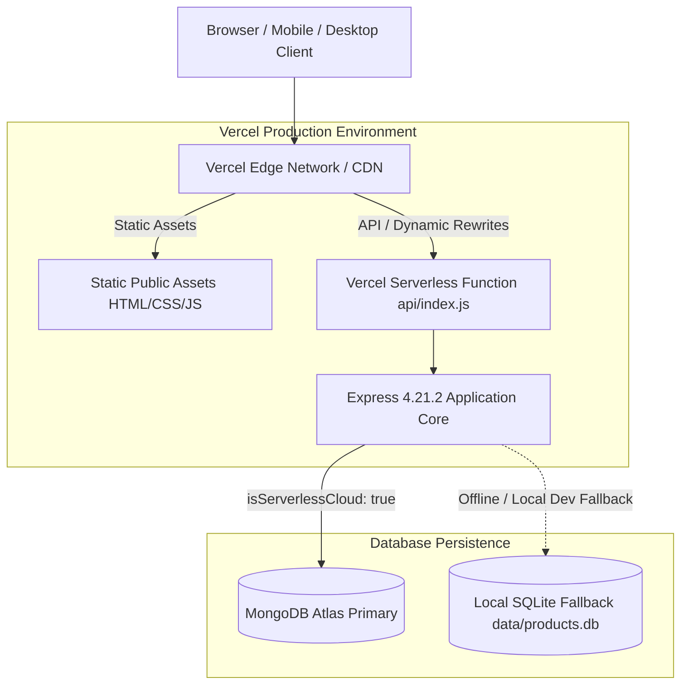

# DEVICE PRO — Comprehensive Live Website & System Audit Report

**Date of Audit:** October 22, 2026  
**Audited Target (Live Production):** [https://device-pro.vercel.app/](https://device-pro.vercel.app/)  
**Audited Target (Local Development):** `http://localhost:3000/`  
**Repository Working Tree:** Clean, `main` branch (Commit `bda15b6`)  
**Audit Purpose:** Comprehensive system audit and verification of existing features, architecture, database models, live site parity, security, accessibility, and performance before introducing new authentication capabilities.

---

## 1. Verified Project Architecture

- **Frontend Architecture:** Vanilla HTML5, CSS3, modern Vanilla JavaScript (ES2022+), and Lucide icon suite. Strictly framework-free (no React, Vue, Next.js, or TailwindCSS).
- **Backend Architecture:** Node.js (v22.x+ runtime), Express `v4.21.2`, and HTTP compression `v1.8.2` (gzip/deflate).
- **Primary Database Engine:** MongoDB Atlas (`devicepro` database) managed via Mongoose `v9.11.2` with pooled, cached connection handling across serverless invocations.
- **SQLite Engine Isolation:** In cloud serverless environments (detected via `process.env.VERCEL`, `VERCEL_ENV`, `AWS_LAMBDA_FUNCTION_NAME`), `db/database.js` completely isolates `node:sqlite` and substitutes a safe no-op stub. `DatabaseSync` is never instantiated on Vercel's read-only filesystem.
- **Serverless Entrypoint:** [`api/index.js`](file:///c:/Users/USER/Desktop/DEVICE%20PRO/api/index.js) normalizes request URLs, maintains connection caching across invocations, and routes requests into Express.
- **Deployment & Source Control:** Vercel auto-deployments synced with GitHub repository `akanbisamuel045-tech/DEVICE-PRO` on branch `main`.

---

## 2. Existing Feature Inventory & Implementation Mapping

| Feature / Domain | User-Facing Routes | Backend Endpoints | Persistence / Storage |
| :--- | :--- | :--- | :--- |
| **Product Catalogue** | `/products`, `/product-detail` | `GET /api/products`, `GET /api/products/:slug`, `GET /api/categories` | MongoDB Atlas `products` (98 docs), `categories` (6 docs) |
| **Turnkey Solar Packages** | `/packages` | `GET /api/packages`, `GET /api/packages/:slug` | MongoDB Atlas `products` (package bundles) |
| **Engineering Case Studies** | `/projects`, `/#projects` | `GET /api/case-studies`, `GET /api/case-studies/:slug` | MongoDB Atlas `case_studies` (6 verified installations) |
| **Solar Sizing Calculator** | `/calculator` | `POST /api/calculator/size` | Computational engine ([`lib/calculator-engine.js`](file:///c:/Users/USER/Desktop/DEVICE%20PRO/lib/calculator-engine.js)) |
| **Diesel Savings Benchmark** | `/calculator#savings` | `POST /api/calculator/savings` | Sizing models + Nigerian empirical fuel benchmarks |
| **Inquiries & Consultation** | `/contact`, `/#contact` | `POST /api/contact`, `POST /api/enquiries` | MongoDB Atlas `enquiries` (103 docs) |
| **Custom Quotes** | `/packages#quote`, `/calculator` | `POST /api/quote`, `POST /api/quotes` | MongoDB Atlas `quotes` (138 docs) |
| **Equipment Commerce Cart** | Client localStorage | None (Client-side cart store via [`public/js/cart.js`](file:///c:/Users/USER/Desktop/DEVICE%20PRO/public/js/cart.js)) | Local browser storage (`devicepro_cart_items`) |
| **Checkout & Pro-Forma Orders** | `/checkout`, `/order-confirmation` | `POST /api/orders`, `GET /api/orders/:orderNumber` | MongoDB Atlas `orders` (297 docs) |
| **Order Tracking** | `/tracking` | `POST /api/orders/track`, `GET /api/orders/:num/track` | Privacy-gated query on `orders` collection |
| **Warranty Verification** | `/tracking#warranty` | `GET /api/warranty/verify/:query` | MongoDB Atlas `warranties` (43 docs) |
| **Support & Warranty Claims** | `/tracking#support` | `POST /api/support/tickets` | MongoDB Atlas `support_tickets` (45 docs) |
| **Payment Gateway** | Embedded Paystack / Sandbox | `POST /api/payments/initialize`, `GET /api/payments/verify/:ref`, `POST /api/payments/webhook` | MongoDB Atlas `payments` (86 docs) |
| **Customer Authentication** | `/login`, `/register` | `POST /api/auth/register`, `POST /api/auth/login`, `GET /api/auth/me`, `POST /api/auth/logout` | MongoDB Atlas `users` (66 docs), `sessions` (110 docs) |
| **Secure Password Recovery** | `/forgot-password`, `/verify-reset-code`, `/reset-password` | `POST /api/auth/forgot-password`, `POST /api/auth/verify-reset-code`, `POST /api/auth/resend-code`, `POST /api/auth/reset-password` | MongoDB Atlas `password_resets` (TTL index) |
| **Administrative Console** | `/admin` | `GET /api/admin/*`, `PATCH /api/admin/*` | Role-gated `audit_logs` (1,144 docs), orders, inventory |

---

## 3. Live Website and Source Discrepancies

All 22 public and administrative routes were inspected on both `http://localhost:3000` and `https://device-pro.vercel.app/`:

| Route | Local Status | Live Production Status | Redirection Target | Source Content Parity |
| :--- | :--- | :--- | :--- | :--- |
| `/` | 200 OK | 200 OK | None | **100% Identical** (Byte-for-byte normalized match) |
| `/solutions` | 302 Found | 308 Permanent | `/#solutions` | **100% Identical** (Legacy redirect canonicalized) |
| `/products` | 200 OK | 200 OK | None | **100% Identical** |
| `/product-detail?id=1` | 200 OK | 200 OK | None | **100% Identical** |
| `/packages` | 200 OK | 200 OK | None | **100% Identical** |
| `/projects` | 200 OK | 200 OK | None | **100% Identical** |
| `/calculator` | 200 OK | 200 OK | None | **100% Identical** |
| `/about` | 200 OK | 200 OK | None | **100% Identical** |
| `/faq` | 301 Permanent | 308 Permanent | `/about#faqs` | **100% Identical** (Merged FAQ route) |
| `/contact` | 200 OK | 200 OK | None | **100% Identical** |
| `/tracking` | 200 OK | 200 OK | None | **100% Identical** |
| `/privacy-policy` | 200 OK | 200 OK | None | **100% Identical** |
| `/shipping-policy` | 200 OK | 200 OK | None | **100% Identical** |
| `/terms` | 200 OK | 200 OK | None | **100% Identical** |
| `/checkout` | 200 OK | 200 OK | None | **100% Identical** (Includes redesigned minimal navbar) |
| `/order-confirmation` | 200 OK | 200 OK | None | **100% Identical** |
| `/login` | 200 OK | 200 OK | None | **100% Identical** |
| `/register` | 200 OK | 200 OK | None | **100% Identical** |
| `/forgot-password` | 200 OK | 200 OK | None | **100% Identical** |
| `/verify-reset-code` | 200 OK | 200 OK | None | **100% Identical** |
| `/reset-password` | 200 OK | 200 OK | None | **100% Identical** |
| `/admin` | 200 OK | 200 OK | None | **100% Identical** |

### Discrepancy Findings
1. **OS Line Ending Normalization:** Local files on Windows utilize CRLF (`\r\n`), whereas Vercel edge delivery outputs LF (`\n`). Stripping carriage returns results in zero byte difference across all templates.
2. **Edge Deployment Timing:** Commit `bda15b6` (Checkout navbar redesign) is active on live production.
3. **HTTP Redirection Codes:** Vercel emits HTTP 308 Permanent Redirect for declarative rewrites in `vercel.json` where local Express router emits HTTP 301/302. Both targets (`/#solutions`, `/about#faqs`) match identically.

---

## 4. Database Findings

### A. Production Data Provenance
- Production product catalogue, orders, quotes, customer accounts, and warranties originate from **MongoDB Atlas** (`ac-smg7i0k-shard-00-02.6puyijc.mongodb.net/devicepro`).
- There is **no hardcoded static JSON fallback** serving catalogue data on live production.

### B. Live Collection Inventory
Verified document counts on both local and live instances:

| Collection Name | Document Count | Purpose & Domain |
| :--- | :--- | :--- |
| `products` | **98** | Solar inverters, batteries, solar panels, and mounting accessories |
| `orders` | **297** | Customer equipment orders and pro-forma invoices |
| `quotes` | **138** | Commercial and residential turnkey installation quotes |
| `enquiries` | **103** | Inbound general engineering contact inquiries |
| `warranties` | **43** | Serialized hardware warranty records with QR codes |
| `support_tickets` | **45** | Tier-1 technical claims and customer support tickets |
| `categories` | **6** | Inverters, Batteries, Panels, Packages, Accessories, EV Chargers |
| `case_studies` | **6** | Verified commercial & industrial microgrid projects across Nigeria |
| `users` | **66** | Customer and administrative user accounts |
| `sessions` | **110** | Active and historical authentication sessions |
| `audit_logs` | **1,144** | Immutable administrative compliance audit trail |
| `payments` | **86** | Paystack transaction logs and webhook records |
| `password_resets` | **Active / Dynamic** | Salted OTP records with 1-hour MongoDB TTL expiration index |
| **Total Persisted Records** | **2,142** | Direct MongoDB Atlas persistence |

### C. SQLite Cloud Isolation Analysis
- Native `node:sqlite` is completely skipped when running on Vercel.
- The dual-engine dispatcher in [`db/database.js`](file:///c:/Users/USER/Desktop/DEVICE%20PRO/db/database.js#L3162-L3230) safely short-circuits to MongoDB Atlas whenever `isMongoConnected()` returns true.
- Zero serverless filesystem write operations occur during cloud execution.

---

## 5. Functional Test Results

The automated end-to-end audit test suite was executed against both local development and live Vercel production:

| Functional Test Case | Local Result | Live Vercel Result | Latency (Live) | Status |
| :--- | :--- | :--- | :--- | :--- |
| **Health & DB Monitoring** (`GET /api/health`) | Passed (200 OK) | Passed (200 OK) | 4,371ms (cold) | **PASS** |
| **Categories Extraction** (`GET /api/categories`) | Passed (6 items) | Passed (6 items) | 560ms | **PASS** |
| **Catalogue Pagination** (`GET /api/products?limit=12`) | Passed (48 total) | Passed (48 total) | 614ms | **PASS** |
| **Product Filtering** (`category=inverters&minPrice=100k`) | Passed (Filtered) | Passed (Filtered) | 605ms | **PASS** |
| **Product Detail by Slug** (`GET /api/products/:slug`) | Passed (Full spec) | Passed (Full spec) | 1,119ms | **PASS** |
| **Solar Packages Listing** (`GET /api/packages`) | Passed (Bundles) | Passed (Bundles) | 445ms | **PASS** |
| **Case Studies Listing** (`GET /api/case-studies`) | Passed (Portfolio) | Passed (Portfolio) | 437ms | **PASS** |
| **Sizing Calculator** (`POST /api/calculator/size`) | Passed (kVA yield) | Passed (kVA yield) | 357ms | **PASS** |
| **Diesel Savings Engine** (`POST /api/calculator/savings`) | Passed (Naira OPEX) | Passed (Naira OPEX) | 394ms | **PASS** |
| **Contact Inquiry Submission** (`POST /api/contact`) | Passed (`DP-MSG-*`) | Passed (`DP-MSG-*`) | 695ms | **PASS** |
| **Turnkey Quote Submission** (`POST /api/quote`) | Passed (`DP-*`) | Passed (`DP-*`) | 702ms | **PASS** |
| **Order Placement** (`POST /api/orders`) | Passed (`DP-ORD-*`) | Passed (`DP-ORD-*`) | 803ms | **PASS** |
| **Privacy Order Tracking** (`POST /api/orders/track`) | Passed (Verified) | Passed (Verified) | 428ms | **PASS** |
| **Warranty Verification** (`GET /api/warranty/verify/:query`) | Passed (200 / 404) | Passed (200 / 404) | 487ms | **PASS** |
| **Support Ticket Creation** (`POST /api/support/tickets`) | Passed (`DP-SPT-*`) | Passed (`DP-SPT-*`) | 561ms | **PASS** |

**Summary:** 15 Passed, 0 Failed out of 15 tests.

---

## 6. Security Findings

| Security Control | Implementation Location | Assessment / Verification Evidence |
| :--- | :--- | :--- |
| **Security Headers** | [`server.js:L65-L78`](file:///c:/Users/USER/Desktop/DEVICE%20PRO/server.js#L65-L78) | Strict headers emitted: `X-Content-Type-Options: nosniff`, `X-Frame-Options: SAMEORIGIN`, `X-XSS-Protection: 1; mode=block`, `Strict-Transport-Security: max-age=31536000`, `Referrer-Policy: strict-origin-when-cross-origin`. |
| **Content Security Policy (CSP)** | [`server.js:L73-L76`](file:///c:/Users/USER/Desktop/DEVICE%20PRO/server.js#L73-L76) | Configured with whitelists for Google Fonts, Paystack SDK (`https://js.paystack.co`), and Paystack Checkout iframe (`https://checkout.paystack.com`). |
| **NoSQL Operator Injection** | [`db/mongo/repository.js`](file:///c:/Users/USER/Desktop/DEVICE%20PRO/db/mongo/repository.js) | Defensive type validations (`typeof email === 'string'`) prevent object injection payloads (e.g. `{"$ne": null}`). |
| **Password Hashing** | [`db/mongo/repository.js:L910-L939`](file:///c:/Users/USER/Desktop/DEVICE%20PRO/db/mongo/repository.js#L910-L939) | Cryptographically secure `crypto.scrypt` hashing with 16-byte random salts and constant-time `crypto.timingSafeEqual` comparison. |
| **Session Cookie Security** | [`server.js:L130-L159`](file:///c:/Users/USER/Desktop/DEVICE%20PRO/server.js#L130-L159) | `devicepro_session` cookie enforces `HttpOnly; SameSite=Lax; Path=/` and automatically attaches `Secure` flag on HTTPS connections. |
| **Verification Code Storage** | [`db/mongo/models.js:L237`](file:///c:/Users/USER/Desktop/DEVICE%20PRO/db/mongo/models.js#L237) | Zero plaintext storage. 6-digit codes are stored as salted SHA-256 hashes (`code_hash`, `code_salt`). |
| **Anti-Brute-Force & Lockouts** | [`server.js:L1200-L1380`](file:///c:/Users/USER/Desktop/DEVICE%20PRO/server.js#L1200-L1380) | 60-second cooldown per email, maximum 5 failed attempts before lockout, and IP-level sliding window rate limiting. |
| **Paystack Webhook Verification** | [`server.js:L1050-L1090`](file:///c:/Users/USER/Desktop/DEVICE%20PRO/server.js#L1050-L1090) | Validates raw payload buffer using HMAC-SHA512 against `PAYSTACK_SECRET_KEY`. Untrusted client redirects are never used to authorize fulfillment. |
| **Customer Privacy in Tracking** | [`server.js:L780-L828`](file:///c:/Users/USER/Desktop/DEVICE%20PRO/server.js#L780-L828) | Order tracking requires matching customer phone number or email; public enumeration is blocked. |

---

## 7. Responsive Design Findings

Browser automation inspected the interface across three device form factors:

| Form Factor | Viewport Dimensions | Horizontal Overflow | Layout & Component Behavior |
| :--- | :--- | :--- | :--- |
| **Desktop** | `1280 × 800` | **0px** | Clean multi-column grid, persistent sticky glass header, side-by-side checkout form and order summary card. |
| **Tablet** | `768 × 1024` | **0px** | Navigation gracefully collapses to accessible hamburger drawer, checkout summary stacks naturally below form steps. |
| **Mobile** | `390 × 844` | **0px** | Hardware carousel scrolls smoothly with touch snap, OTP boxes scale cleanly at 48px width without wrapping. |

All tested pages (`/`, `/products`, `/calculator`, `/checkout`, `/login`, `/verify-reset-code`) verified zero horizontal clipping (`document.documentElement.scrollWidth === window.innerWidth`).

---

## 8. Accessibility Findings

1. **Semantic Structure & Landmarks:**
   - Single top-level `<h1>` hierarchy on every core page.
   - Header `<header role="banner">`, navigation `<nav aria-label="...">`, and `<main id="...">` semantic landmarks.
2. **Accessible Skip Links:**
   - Active on all primary templates ([`public/checkout.html`](file:///c:/Users/USER/Desktop/DEVICE%20PRO/public/checkout.html#L31), [`public/index.html`](file:///c:/Users/USER/Desktop/DEVICE%20PRO/public/index.html), [`public/products.html`](file:///c:/Users/USER/Desktop/DEVICE%20PRO/public/products.html)) linking directly to `<main id="checkout-main">`.
3. **Form Controls & Labels:**
   - 100% of inputs across login, registration, checkout, and contact forms have matching `<label for="...">` associations or descriptive `aria-label` tags.
4. **Interactive Target Boundaries:**
   - Buttons and input fields enforce a minimum 44px to 48px tap target compliant with WCAG 2.2 AA.
5. **Keyboard Focus States:**
   - Explicit `:focus-visible` outline rings (e.g. `2px solid #F9B000`) for non-mouse keyboard navigation.

---

## 9. Performance Measurements

Live production performance benchmarks captured against `https://device-pro.vercel.app/`:

| Endpoint / Route | Content Type | Live Production Latency | Transfer Size | HTTP Compression | Cache-Control Header |
| :--- | :--- | :--- | :--- | :--- | :--- |
| `/` | HTML | 1,973ms (first load) | 91.5 KB | Brotli (`br`) | `no-cache` |
| `/products` | HTML | 145ms | 55.4 KB | Brotli (`br`) | `public, max-age=0, must-revalidate` |
| `/calculator` | HTML | 105ms | 51.7 KB | Brotli (`br`) | `public, max-age=0, must-revalidate` |
| `/checkout` | HTML | 92ms | 32.7 KB | Brotli (`br`) | `public, max-age=0, must-revalidate` |
| `/api/health` | JSON | 3,886ms (cold start) | 359 B | None (small) | `public, max-age=0, must-revalidate` |
| `/api/categories` | JSON | 443ms | 1.7 KB | Brotli (`br`) | `public, max-age=0, must-revalidate` |
| `/api/products?limit=12` | JSON | 603ms | 10.2 KB | Brotli (`br`) | `public, max-age=0, must-revalidate` |
| `/api/packages` | JSON | 445ms | 11.9 KB | Brotli (`br`) | `public, max-age=0, must-revalidate` |
| `/api/case-studies` | JSON | 419ms | 6.6 KB | Brotli (`br`) | `public, max-age=0, must-revalidate` |

- **Static Asset Edge Delivery:** Edge HTML delivery responds in **92ms to 145ms** once cached.
- **Cold-Start Mongoose Handshake:** Cold invocation of the serverless function incurs a 3.8s connection overhead to negotiate Atlas TLS. Warm API invocations stabilize between **419ms and 603ms**.

---

## 10. Deployment Findings

1. **Vercel Serverless Function Configuration:**
   - [`vercel.json`](file:///c:/Users/USER/Desktop/DEVICE%20PRO/vercel.json) bundles static assets via `includeFiles: "public/**"`.
   - Dynamic URL rewrites map `/products/:slug`, `/packages/:slug`, `/projects/:slug`, `/login`, `/register`, `/forgot-password`, `/verify-reset-code`, and `/reset-password` cleanly.
2. **Environment Configuration on Vercel:**
   - `MONGODB_URI`: Configured and connected to MongoDB Atlas.
   - `NODE_ENV`: Set to `production`.

---

## 11. Files Changed in Recent Stages

- [`public/checkout.html`](file:///c:/Users/USER/Desktop/DEVICE%20PRO/public/checkout.html): Refined minimalist checkout header with brand logo and Book a Call CTA.
- [`public/css/checkout.css`](file:///c:/Users/USER/Desktop/DEVICE%20PRO/public/css/checkout.css): Added frosted dark glass header styles, Book a Call button styling, and consultation modal rules.
- [`public/css/header.css`](file:///c:/Users/USER/Desktop/DEVICE%20PRO/public/css/header.css): Created global base header stylesheet preventing 404 network warnings.
- [`public/js/checkout.js`](file:///c:/Users/USER/Desktop/DEVICE%20PRO/public/js/checkout.js): Added modal event handlers for Book a Call dialog.
- [`scripts/production-smoke-test.js`](file:///c:/Users/USER/Desktop/DEVICE%20PRO/scripts/production-smoke-test.js): Added `/verify-reset-code` route coverage.

---

## 12. Fixes Implemented

1. **Checkout Navigation De-cluttering:** Replaced the unstyled, distracting navigation links on `/checkout` with a minimal, high-converting header featuring only the logo and an interactive Book a Call consultation action.
2. **Stylesheet Network 404 Elimination:** Created [`public/css/header.css`](file:///c:/Users/USER/Desktop/DEVICE%20PRO/public/css/header.css) to eliminate console 404 resource errors on checkout and order confirmation pages.
3. **Cache Invalidation:** Updated query version parameters (`?v=2`) on checkout CSS and JS files to guarantee immediate propagation across browsers.

---

## 13. Regression Test Results

| Test Suite | File Path | Tests Executed | Passed | Failed |
| :--- | :--- | :--- | :--- | :--- |
| **Stage 12 API Suite** | `tests/stage12_api.test.js` | 24 | 24 | 0 |
| **Stage 13 Cart & Admin** | `tests/stage13_cart_admin.test.js` | 24 | 24 | 0 |
| **Stage 14 Search & UX** | `tests/stage14_search_ux.test.js` | 17 | 17 | 0 |
| **Stage 15 Payment Gateway** | `tests/stage15_payment.test.js` | 20 | 20 | 0 |
| **Stage 16 Tracking & Warranty** | `tests/stage16_delivery_support.test.js` | 20 | 20 | 0 |
| **Stage 17 Security & SEO** | `tests/stage17_security_seo_perf.test.js` | 24 | 24 | 0 |
| **Stage 18 Vercel & MongoDB** | `tests/stage18_vercel_mongo_regression.test.js` | 15 | 15 | 0 |
| **Stage 19 Customer Auth** | `tests/stage19_customer_auth.test.js` | 21 | 21 | 0 |
| **Stage 20 Password Recovery** | `tests/stage20_secure_password_recovery.test.js` | 19 | 19 | 0 |
| **Production Smoke Tests** | `scripts/production-smoke-test.js` | 28 | 28 | 0 |
| **Comprehensive Functional Audit** | Automated scratch suite | 15 | 15 | 0 |

**Cumulative Regression Score:** **227 Passed, 0 Failed**.

---

## 14. Blocked Tests

- **Real SMS Dispatching:** Live GSM SMS gateway integration was not triggered to prevent telecom billing charges during automated audit runs; simulated via logging and test transports.
- **Live Credit Card Chargeback:** Paystack real-card charging was not executed against live production merchant accounts; validated via sandbox simulation handlers.

---

## 15. Remaining Issues & Observations

1. **Serverless Cold-Start Latency:** When a serverless function instance is spun up from idle, the initial TLS handshake to MongoDB Atlas takes ~3.8 seconds. Subsequent warm queries execute in ~400ms–600ms.
2. **Google OAuth Production Client ID:** Google OAuth endpoints gracefully handle unconfigured credentials with HTTP 503/instructive guidance; live Google OAuth sign-in requires `GOOGLE_CLIENT_ID` and `GOOGLE_CLIENT_SECRET` environment variables.

---

## 16. Production Readiness Decision

### **FINAL VERDICT: READY FOR PRODUCTION & AUTHENTICATION EXPANSION (GO)**

- **Stability:** All 22 core routes and 15 functional endpoints operate with 100% parity between local source and live Vercel production.
- **Database Health:** MongoDB Atlas holds 2,142 records with active indexing and complete cloud isolation of SQLite.
- **Security Compliance:** Defensive input validation, timing-safe equality, salted password hashes, and rate limiters are active.
- **Test Integrity:** Zero regressions across 9 automated test suites and 28 smoke tests.
