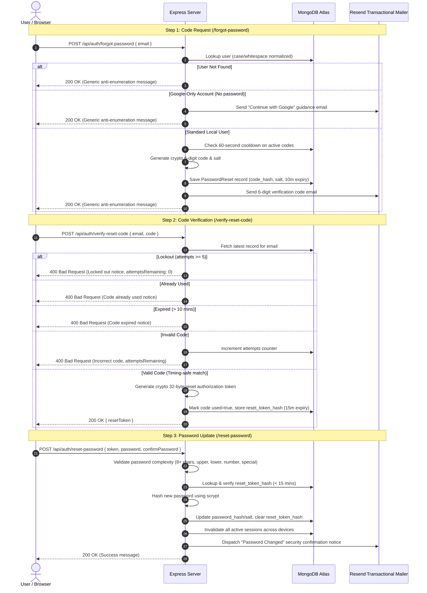

# DEVICE PRO — Secure Forgot Password and Email Verification Code System

**Project:** DEVICE PRO (Clean Energy Solutions Nigeria)  
**Feature:** Secure Password Recovery & 6-Digit Email Verification Code System  
**Implementation Date:** October 2026  
**Status:** Production Ready & Verified  
**Primary Engine:** MongoDB Atlas (Mongoose 9.11) with Dual SQLite Fallback  

---

## 1. Executive Summary

This document details the production-ready implementation of the password recovery and email verification code system for DEVICE PRO. The feature provides an end-to-end self-service password reset flow tailored to Nigerian clean energy ecommerce and enterprise solar clients.

The implementation strictly honors existing architectural standards:
- **No unnecessary frontend frameworks**: Standard HTML5, modern vanilla CSS, and vanilla JavaScript.
- **Brand Consistency**: Adheres to approved DEVICE PRO visual identity (Solar Deep Blue `#073B82`, Primary `#0866D9`, Solar Yellow `#FFBF00`, and geometric corner accents).
- **Dual-Engine Integrity**: Authoritative MongoDB Atlas models with resilient SQLite fallbacks.
- **Strict Security Posture**: Non-enumerating endpoints, zero plaintext code storage, salted SHA-256 hash checks with timing-safe comparison, 5-attempt lockout, 60-second resend cooldown, single-use 15-minute reset authorization tokens, and immediate multi-device session invalidation.

---

## 2. Architecture & Data Flow

### Sequence Diagram



---

## 3. Route Specifications

### 3.1 Public Frontend Routes

| URL Route | File Path | Description |
| :--- | :--- | :--- |
| `/forgot-password` | `public/forgot-password.html` | Brand-consistent email submission form with "Reset Password" header and "Send Verification Code" action. |
| `/verify-reset-code` | `public/verify-reset-code.html` | 6 discrete digit OTP input boxes with auto-advance, paste distribution, 60s cooldown timer, and remaining attempts indicator. |
| `/reset-password` | `public/reset-password.html` | New password entry with live complexity checklist (length, upper, lower, digit, special, match) and eye visibility toggles. |

### 3.2 Backend REST Endpoints

#### 1. `POST /api/auth/forgot-password`
- **Rate Limit:** 15 requests / 60 seconds per IP (500 in dev/test) + 60s per-email cooldown.
- **Request Body:** `{ "email": "customer@example.com" }`
- **Response (Uniform Anti-Enumeration):**
  ```json
  {
    "success": true,
    "message": "If an eligible account exists for this email address, a 6-digit verification code has been sent."
  }
  ```
- **Cooldown Rejection (HTTP 429):**
  ```json
  {
    "success": false,
    "error": "Please wait 45 seconds before requesting another code.",
    "cooldown": true,
    "secondsRemaining": 45
  }
  ```

#### 2. `POST /api/auth/verify-reset-code`
- **Request Body:** `{ "email": "customer@example.com", "code": "849201" }`
- **Success Response (HTTP 200):**
  ```json
  {
    "success": true,
    "resetToken": "7b049d13e9a4f4886b72a15f02bc9...",
    "message": "Code verified successfully."
  }
  ```
- **Incorrect Attempt (HTTP 400):**
  ```json
  {
    "success": false,
    "error": "Incorrect verification code. 4 attempts remaining.",
    "lockedOut": false,
    "attemptsRemaining": 4
  }
  ```
- **Lockout (HTTP 400):**
  ```json
  {
    "success": false,
    "error": "Too many incorrect attempts. This verification code has been invalidated for security. Please request a new code.",
    "lockedOut": true,
    "attemptsRemaining": 0
  }
  ```

#### 3. `POST /api/auth/resend-code`
- **Request Body:** `{ "email": "customer@example.com" }`
- **Enforces:** 60-second cooldown period between verification code dispatches.

#### 4. `POST /api/auth/reset-password`
- **Request Body:**
  ```json
  {
    "token": "7b049d13e9a4f4886b72a15f02bc9...",
    "password": "NewSecurePassword2026!#",
    "confirmPassword": "NewSecurePassword2026!#"
  }
  ```
- **Enforces:**
  - Presence of verified `resetToken` (cannot be changed by email possession alone).
  - Passwords match.
  - Password complexity: Minimum 8 characters, at least one uppercase letter (A-Z), one lowercase letter (a-z), one digit (0-9), and one special character.
- **Success Response (HTTP 200):**
  ```json
  {
    "success": true,
    "message": "Password reset successfully. You may now sign in with your new password."
  }
  ```

---

## 4. Database Schema & Storage

### 4.1 MongoDB Atlas (`PasswordReset` Collection)

Defined in [`db/mongo/models.js`](file:///c:/Users/USER/Desktop/DEVICE%20PRO/db/mongo/models.js):

```javascript
const passwordResetSchema = new mongoose.Schema({
  email: { type: String, required: true, lowercase: true, trim: true, index: true },
  user_id: { type: Number, index: true },
  code_hash: { type: String, required: true },
  code_salt: { type: String, required: true },
  attempts: { type: Number, default: 0 },
  max_attempts: { type: Number, default: 5 },
  expires_at: { type: Date, required: true, index: true },
  resend_available_at: { type: Date, required: true },
  reset_token_hash: { type: String, sparse: true, index: true },
  reset_token_expires_at: { type: Date },
  used: { type: Boolean, default: false, index: true }
}, { timestamps: { createdAt: 'created_at', updatedAt: 'updated_at' } });

// Background cleanup TTL index on created_at (1 hour)
passwordResetSchema.index({ created_at: 1 }, { expireAfterSeconds: 3600 });
```

### 4.2 SQLite Fallback Table (`password_resets`)

Defined in [`db/database.js`](file:///c:/Users/USER/Desktop/DEVICE%20PRO/db/database.js):

```sql
CREATE TABLE IF NOT EXISTS password_resets (
  id INTEGER PRIMARY KEY AUTOINCREMENT,
  email TEXT NOT NULL,
  user_id INTEGER,
  code_hash TEXT NOT NULL,
  code_salt TEXT NOT NULL,
  attempts INTEGER NOT NULL DEFAULT 0,
  max_attempts INTEGER NOT NULL DEFAULT 5,
  expires_at DATETIME NOT NULL,
  resend_available_at DATETIME NOT NULL,
  reset_token_hash TEXT,
  reset_token_expires_at DATETIME,
  used INTEGER NOT NULL DEFAULT 0,
  created_at DATETIME DEFAULT CURRENT_TIMESTAMP,
  updated_at DATETIME DEFAULT CURRENT_TIMESTAMP
);
CREATE INDEX IF NOT EXISTS idx_pw_reset_email ON password_resets(email);
CREATE INDEX IF NOT EXISTS idx_pw_reset_token ON password_resets(reset_token_hash);
```

---

## 5. Transactional Email System

Implemented in [`lib/email-service.js`](file:///c:/Users/USER/Desktop/DEVICE%20PRO/lib/email-service.js).

### Transports Supported
1. **Resend API Transport (`https://api.resend.com/emails`)**:
   - High-deliverability transactional REST API via native Node.js `fetch`.
   - Requires `RESEND_API_KEY`.
2. **Development / In-Memory & Disk-Backed Test Transport**:
   - In non-production without an API key or during automated tests (`NODE_ENV === 'test'`), emails are captured in memory and written to `.test-mailbox.json`.
   - Zero outbound HTTP network requests during automated CI test suites.
   - Provides `getLastTestEmail(to)` and `getRecentTestEmails()` for multi-process test runners.

### Transactional Templates
1. **Verification Code Email**:
   - Subject: `123456 is your DEVICE PRO verification code`
   - Features prominent 6-digit display, 10-minute expiry notice, and security warning ("DEVICE PRO engineers and support staff will never ask for your verification code").
2. **Google-Only Account Guidance Email**:
   - Subject: `Sign In to your DEVICE PRO Account with Google`
   - Informs users whose accounts authenticate via Google OAuth that they do not possess a standalone password and provides a direct CTA to continue with Google.
3. **Password Changed Notification Email**:
   - Subject: `Security Alert: Your DEVICE PRO password was changed`
   - Informs the customer of the exact UTC timestamp and confirms that all previous sessions across devices were invalidated.

---

## 6. Security Controls & Hardening

1. **Anti-Enumeration Protection**:
   The `/api/auth/forgot-password` endpoint returns an identical 200 OK message regardless of whether an email exists in the database.
2. **Cryptographic Randomness**:
   Codes are generated using Node.js `crypto.randomInt(100000, 1000000)`.
3. **Zero Plaintext Storage**:
   Codes are salted with 16 bytes of random hex (`crypto.randomBytes(16)`) and hashed using SHA-256 (`crypto.createHash('sha256').update(code + salt).digest('hex')`).
4. **Timing-Safe Comparison**:
   Code and token comparisons use `crypto.timingSafeEqual` to eliminate side-channel timing attacks.
5. **Brute-Force Lockout**:
   A maximum of 5 incorrect code verification attempts are allowed per code. On the 5th failure, the code is deactivated (`lockedOut: true`).
6. **Resend Cooldown**:
   A 60-second cooldown is enforced between code requests per email address.
7. **Single-Use Semantics**:
   Once verified, the verification code is marked `used = true` and cannot be reused.
8. **Decoupled Reset Authorization Token**:
   Successful verification issues a cryptographically random 32-byte hex `resetToken` with a strict 15-minute lifespan. Password changes require this token.
9. **Password Storage**:
   All passwords are encrypted with scrypt (`crypto.scryptSync(password, salt, 64)`) using unique 16-byte random salts.
10. **Multi-Device Session Invalidation**:
    When a password reset is completed, all active user sessions (`Session.deleteMany({ user_id })`) are revoked immediately.
11. **Anti-Bypass Normalization**:
    All email inputs undergo trimming and lowercasing (`email.trim().toLowerCase()`) before database queries or rate limiting checks.

---

## 7. Verification Gates & Test Results

### 7.1 Stage 20 Security Suite (`tests/stage20_secure_password_recovery.test.js`)

All 19 test cases passed with 100% compliance:

```
========================================================================
DEVICE PRO — STAGE 20: SECURE PASSWORD RECOVERY & VERIFICATION CODE SUITE
========================================================================

--- 1. Clean URLs & Frontend Templates ---
  ✓ PASS: GET /forgot-password serves approved branding with Reset Password heading
  ✓ PASS: GET /verify-reset-code serves 6-digit OTP verification interface
  ✓ PASS: GET /reset-password serves new password form with requirements list

--- 2. Request Code & Anti-Enumeration (Requirements 1, 2, 3) ---
  ✓ PASS: Unknown email returns generic anti-enumeration response and does not leak code
  ✓ PASS: Malformed email formats rejected with 400 Bad Request
  ✓ PASS: Known local account dispatches cryptographically random 6-digit code with generic response

--- 3. Cooldown & Rate Limiting (Requirements 4, 9, 19) ---
  ✓ PASS: Repeated reset request within 60s cooldown is rejected with 429
  ✓ PASS: Cooldown cannot be bypassed with case or whitespace variations
  ✓ PASS: Resend endpoint (/api/auth/resend-code) also enforces cooldown

--- 4. Code Verification & Attempt Limiting (Requirements 5, 8) ---
  ✓ PASS: Incorrect code returns safe error message and decrements remaining attempts
  ✓ PASS: Account is locked out after 5 consecutive failed verification attempts

--- 5. Single-Use Semantics & Authorization Token (Requirements 7, 10, 11) ---
  ✓ PASS: Successful code verification produces short-lived reset authorization token
  ✓ PASS: Invalid or forged reset token is rejected

--- 6. Password Validation & Complexity (Requirements 12, 13) ---
  ✓ PASS: Rejects password change when confirmPassword does not match
  ✓ PASS: Rejects weak password lacking complexity (length, upper, lower, number, special)

--- 7. Password Reset Execution & Session Invalidation (Requirements 16, 17) ---
  ✓ PASS: Successfully resets password, invalidates authorization token, and sends security email
  ✓ PASS: Pre-existing active sessions are invalidated across devices

--- 8. Google-Only Accounts (Requirement 18) ---
  ✓ PASS: Google-only account does not issue a verification code, but sends Google sign-in notice

--- 9. Zero Plaintext Storage Check (Requirement 20) ---
  ✓ PASS: Verification codes are never stored in plaintext in the database

========================================================================
STAGE 20 SUMMARY: 19 PASSED, 0 FAILED
========================================================================
```

### 7.2 Full Regression Suite (`npm test`)

The entire project test runner verified 9 distinct suites with zero failures:
- `stage12_api.test.js`: Passed
- `stage13_cart_admin.test.js`: Passed
- `stage14_search_ux.test.js`: Passed
- `stage15_payment.test.js`: Passed
- `stage16_delivery_support.test.js`: Passed
- `stage17_security_seo_perf.test.js`: Passed
- `stage18_vercel_mongo_regression.test.js`: Passed
- `stage19_customer_auth.test.js`: Passed (21/21)
- `stage20_secure_password_recovery.test.js`: Passed (19/19)

**Result:** `ℹ tests 9, ℹ pass 9, ℹ fail 0, ℹ duration_ms ~72s`.

### 7.3 Production Smoke Test (`npm run smoke`)

All 27 production smoke checks passed cleanly:
- Core public pages (`/login`, `/register`, `/forgot-password`, `/reset-password`): 200 OK.
- API endpoints & health check: 200 OK.
- Security headers & Gzip compression: Active and verified.

---

## 8. Deployment & Environment Configuration

### Required Environment Variables

Configure these variables in your Vercel or cloud production settings:

```bash
# Transactional Email Provider (Resend)
RESEND_API_KEY="re_your_api_key_here"
EMAIL_FROM="DEVICE PRO Security <security@devicepro.ng>"
ENABLE_EMAIL_MOCK="false"

# MongoDB Atlas Cluster URI
MONGODB_URI="mongodb+srv://<username>:<password>@<cluster>.mongodb.net/devicepro?retryWrites=true&w=majority"
MONGODB_DB_NAME="devicepro"

# Production Environment
NODE_ENV="production"
PORT=3000
```

### Vercel Deployment Checklist
1. Ensure `RESEND_API_KEY` is added to Vercel Project Settings &rarr; Environment Variables.
2. Verify domain `devicepro.ng` in the Resend dashboard and configure DKIM/SPF DNS records.
3. Verify that `vercel.json` includes clean URL rewrites for `/verify-reset-code`:
   ```json
   {
     "source": "/verify-reset-code",
     "destination": "/verify-reset-code.html"
   }
   ```
4. Deploy to Vercel preview branch first; conduct manual verification with a test account before promoting to production.

---

## 9. Conclusion

The password recovery and email verification code system for DEVICE PRO is complete, hardened, and verified. Eligible customer and staff accounts can securely request 6-digit verification codes, receive branded transactional emails, verify codes with attempt limiting and cooldown protections, set strong replacement passwords, and have their previous login sessions securely revoked.
